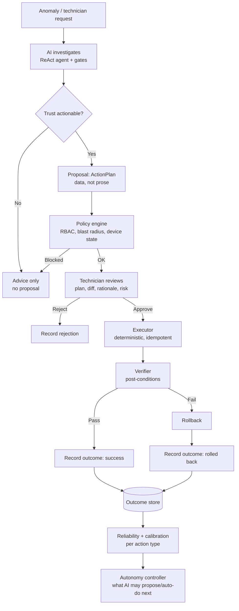

# AI Task Delegation — Approval-Gated Device Actions

> **Status:** Draft / proposed
> **Goal:** the AI proposes a complete device-management action (or batch); a
> technician reviews and approves it; the system executes deterministically; the
> result is verified and recorded; measured reliability expands what the AI may
> handle over time.
> **Related:** [Agentic AI](ai-agentic.md) | [Trust & Validation Gates](ai-validation-gates.md) | [Provenance & Outcomes](provenance-and-outcomes.md) | [KPI Evaluation Roadmap](kpi-evaluation-roadmap.md) | [Device Configuration (MDM)](device-configuration-mdm.md) | [RBAC Hardening Plan](rbac-hardening-plan.md) | [Audit & Compliance](audit-compliance.md)
>
> **Implemented:** nothing in this document yet — it specifies the work.
> This extends the "Future Expansion" items already listed in
> [Agentic AI](ai-agentic.md) — *Tool proposal validation* and
> *Human-in-the-loop: technician can approve/reject the agent's proposed
> actions* — into a concrete design.

---

## 1. Why this document

The AI today is read-only: it investigates and **recommends**, and a human does
everything else. The product goal is to **delegate device-management tasks to
the AI**, with a technician kept on the side for final approval. That is a
different class of system: the AI is no longer just answering, it is *proposing
work to be done on real devices*.

The trust architecture already in place (validation gates, a trust envelope, an
audit trail, command plumbing, and outcome columns) gives us most of the
foundation. What is missing is the layer that turns a recommendation into a
**reviewable, executable, reversible action** — and the feedback loop that
proves the recommendation was good. This document defines that layer.

## 2. Goal and autonomy level

This plan targets **Level 2 autonomy — approval-gated execution**:

| Level | Who decides what | Who does it | Who approves |
|---|---|---|---|
| 0 — Read-only | AI answers | — | n/a |
| 1 — Recommend | AI proposes in text | human | — |
| **2 — Delegate (this plan)** | **AI proposes a plan** | **system (deterministic)** | **technician** |
| 3 | AI may auto-run low-risk, reversible actions | system | after the fact |

We deliberately design for Level 2 but structure the data so Level 3 can be
**earned per action type** from measured reliability — never granted globally.

The governing safety rule:

> **The AI never mutates state. It emits a structured, validated *plan*. A
> deterministic executor applies it, after policy checks and technician
> approval.**

The LLM's job shrinks to *propose*. Boring, testable code does the *doing*.

---

## 2.1 The trust triangle

Three pillars, only the first of which exists today:

```
        Explainability            Outcome tracking
        "why this proposal"  +    "was it right?"     =  verifiable trust
              \                         /
               \                       /
                Safe execution layer
                "what we did & how to undo it"
```

- **Explainability** — already partly present: the trust envelope
  (`EnvelopeResult.trust_score`, `passed_gate_ids`, `failed_gate_id`) and cited
  `EvidenceRef`s. This document makes it a first-class part of a proposal.
- **Outcome tracking** — partly present in `configuration_history` and
  `job_outcomes` (see §12); needs to be extended to *proposals*.
- **Safe execution layer** — new. This is the bulk of the work.

Trust for delegation is **empirical**: it is earned by measured outcomes per
action type, not asserted by a gate.

---

## 3. What already exists — build on this, don't rebuild

| Capability | Where | Reuse as |
|---|---|---|
| Trust envelope + `actionable` flag | `ai/gates/envelope.py` (`EnvelopeResult`) | Gating: only `is_actionable` proposals may be approved |
| Gate D (permissions) / Gate E (lifecycle) | `ai/gates/gate_d.py`, `ai/gates/gate_e.py` | Pre-execution policy checks (already sketched in [ai-agentic.md](ai-agentic.md:210)) |
| Agentic ReAct loop | `ai/agent.py` (`run_agent`, `MAX_ITERATIONS=5`, `TOTAL_TIMEOUT=60`) | "Investigate, then propose" — a proposal tool plugs into the existing loop |
| Command queue + permissions | `DeviceCommandsEndpoint.py` (`queue_command`), `command_poller.py` (`COMMAND_TYPES`, `required_permissions_for_command`) | The executor's only mutate path
- **Configuration outcome fields** — `ConfigurationHistory.change_type` already
  supports `'ai_recommended'`, plus `was_successful`, `was_rolled_back`,
  `rollback_reason`, `rollback_success`, `rollback_performance`, `provenance`
  (`backend/src/homepot/app/models/AnalyticsModel.py:211`).
- **Command outcome fields** — `device_commands.sent_at`, `issued_by`
  (`migrations/versions/20260816_add_command_and_config_outcome_tracking.py`).
- **Audit trail** — `homepot.audit` with `AI_QUERY` / `AI_GATE_FAILURE`
  event types and full metadata (`backend/src/homepot/audit.py`).
- **KPIs** — MW-03/04/05 (config success, verified improvement, rollback
  effectiveness) and AI-01…04 (`docs/kpi-evaluation-roadmap.md`).
- **RBAC vocabulary** — `Admin` / `Technician`, `is_privileged`,
  `verify_device_belongs_to_user(..., minimum_role=...)`
  (`backend/src/homepot/app/roles.py`).
- **Simulators** — device emulators + `DeviceSimulatorEndpoint.py`, so first
  execution can run against a simulated fleet.

---

## 4. Scope & non-goals

**In scope**

- A **proposal** object the AI produces (structured, explained, risk-tiered).
- A **policy engine** (RBAC + blast radius + device state) as pre-execution gate.
- A **technician approval** step (UI + audit).
- A **deterministic executor** that reuses the existing command/config paths.
- **Verification + rollback** and **outcome recording**.
- An **autonomy controller** driven by measured reliability.

**Non-goals (for now)**

- Fully autonomous (no-approval) actions — that is Level 3+, gated on data.
- New device capabilities — the executor can only do what the agent already can
  (`COMMAND_TYPES`).
- Replacing the technician or the existing command UI.
- Multi-agent planning / model upgrade (that is [Agentic AI](ai-agentic.md)
  Tier 2/3).

---

## 5. System flow



The key property: **the AI can only ever hand off a plan.** Nothing between the
proposal and the executor is LLM-generated.

---

## 6. Proposal lifecycle

An `ActionPlan` moves through an explicit state machine; every transition is
audited.

| State | Meaning | Who moves it |
|---|---|---|
| `proposed` | AI produced a plan, policy check pending | system |
| `blocked` | Policy engine rejected (RBAC/state/blast radius) | system |
| `pending_approval` | Policy passed; waiting on a technician | system |
| `approved` / `rejected` | Technician decision recorded | technician |
| `executing` | Executor running steps | system |
| `succeeded` | All steps verified | system |
| `failed` | A step failed; see rollback | system |
| `rolled_back` | Reverted to pre-action state | system |
| `expired` | Not approved within a window | system |

Terminal: `succeeded`, `failed`, `rolled_back`, `rejected`, `expired`, `blocked`.

---

## 7. Components & where they live

| Component | Location | Responsibility |
|---|---|---|
| **Proposal tools** | extend `ai/tools.py` | Read-only investigation tools (existing) **plus** proposal-only tools that emit an `ActionPlan`; never execute |
| **`ai_ops` service** | new `backend/src/homepot/app/ai_ops/` | registry, policy, approval, executor, verifier, rollback |
| **Action registry** | `ai_ops/registry.py` | Declares each capability + risk tier + reversibility + required permission |
| **Policy engine** | `ai_ops/policy.py` | RBAC, blast radius, device state, maintenance windows; wraps Gate D/E |
| **Executor** | `ai_ops/executor.py` | Deterministic, idempotent; calls the **same** command/config paths as the UI |
| **Verifier** | `ai_ops/verifier.py` | Post-conditions via existing health/metrics |
| **Rollback** | `ai_ops/rollback.py` | Inverse ops / snapshot restore |
| **API** | new `AIActionsEndpoint.py` | `POST /propose`, `GET /`, `POST /{id}/approve`, `/reject`, `/execute` |
| **Data model** | new models + Alembic | `ai_action_plan`, `ai_action_step`, `ai_approval`, `ai_outcome` |
| **Metrics** | extend `ai/analytics_service.py` | Reliability + confidence calibration per action type |
| **UI** | frontend | "AI Proposals" queue: plan, target(s), diff, rationale, risk, approve/reject, outcome |

Design rule: the executor must **reuse `DeviceCommandsEndpoint` /
`AgentConfigHistoryEndpoint` behaviour, not re-implement it**, so there is a
single audited path to every device.

---

## 8. Data model (new tables)

```text
ai_action_plan
  plan_id            uuid pk
  created_at         timestamptz
  source_query_id    uuid        -- links to the AI query / audit event
  trust_mode         text        -- from EnvelopeResult
  trust_score        float
  passed_gates       jsonb       -- e.g. ["A","B","C","D","E","C"]
  failed_gate        text null
  risk_tier          text        -- T1..T4 (see §9)
  status             text        -- §6 state machine
  rationale          text        -- human-readable "why"
  evidence           jsonb       -- list of EvidenceRef
  reversible         boolean
  created_by         text        -- user id/email

ai_action_step
  step_id            uuid pk
  plan_id            uuid fk
  seq                int
  action             text        -- e.g. "update_config", "restart"
  target_device_id   text
  params             jsonb
  preconditions      jsonb
  postconditions     jsonb       -- how the verifier checks success
  rollback_params    jsonb null
  status             text        -- pending/running/done/failed/skipped
  command_id         text null   -- links to device_commands

ai_approval
  approval_id        uuid pk
  plan_id            uuid fk
  actor              text        -- technician id/email
  decision           text        -- approved/rejected
  reason             text null
  decided_at         timestamptz
  device_scope       jsonb       -- what scope the actor was allowed to approve

ai_outcome
  outcome_id         uuid pk
  plan_id            uuid fk
  verified           boolean
  metrics_before     jsonb
  metrics_after      jsonb
  rolled_back        boolean
  rollback_success   boolean null
  error              text null
  recorded_at        timestamptz
  provenance         text        -- real/controlled/simulated
```

Where an outcome is a configuration change, we continue to write
`configuration_history` (with `change_type='ai_recommended'`) so existing KPIs
(MW-03/04/05) work unchanged; `ai_outcome` adds the proposal-level link.

---

## 9. Action registry & risk tiers

Each capability is declared, with the data that drives policy and approval:

| Tier | Example actions | Reversible | Approval |
|---|---|---|---|
| **T1** read-only | diagnostics, `health_check`, `ping`, `status_request` | n/a | none |
| **T2** reversible | `update_config` (with snapshot), `restart` | yes | technician |
| **T3** disruptive | `run_script`, fleet-wide config rollout | maybe | senior / batch approval |
| **T4** destructive | `shutdown`, wipe/lock | no | out of scope for v1 |

v1 is deliberately limited to **T2 on a single device against the simulator**.

Registry entry sketch:

```python
ActionSpec(
    name="update_config",
    command_type="update_config",          # must exist in COMMAND_TYPES
    risk_tier="T2",
    reversible=True,
    required_permission="root_access",     # from REQUIRED_PERMISSION
    min_role="operator",
    preconditions=["device ACTIVE", "device online", "snapshot available"],
    postconditions=["config applied", "health still OK"],
    rollback="restore snapshot",
)
```

---

## 10. Approval & RBAC

- Approval is a **privileged action** and must be **role- and scope-checked**:
  a technician may only approve actions for devices/sites they belong to. Use
  `verify_device_belongs_to_user(db_user, device, sync_db, minimum_role="operator")`
  (as the command endpoint already does), **not** a bare admin check.
- **Important caveat:** `HOMEPOT_DEV_UNIFIED_ACCESS` currently defaults to `True`
  (`roles.py`), so `is_privileged()` returns `True` for everyone during
  development. The approval gate must therefore key off device membership +
  minimum role, and be validated against the [RBAC Hardening Plan](rbac-hardening-plan.md)
  before production. The plan's DoD — *"every privileged action records its
  actor"* — is a hard prerequisite for this feature.
- Approval may be **per-action** (v1) or **per-plan/batch** (later). Batch
  approval requires a **blast-radius policy** (max devices, max sites) and a
  dry-run diff for the whole batch.

---

## 11. Explainability surface

What the technician sees before approving — the three moments:

1. **At proposal:** plan summary, per-step target(s), config **diff**, rationale,
   cited evidence, which gates passed, trust score, risk tier, and reversibility
   / rollback plan.
2. **At decision:** a **dry-run preview** (what would change, validated against
   the simulator or a read-only diff), so approval is informed.
3. **Post-hoc:** the audit trail + `ai_outcome` record, plus the track record for
   that action type ("`update_config` succeeded 47/50 times, avg verify 12s").

Explainability without outcome tracking is a plausible story. Explainability
**plus** outcomes is verifiable trust.

---

## 12. Outcome tracking & metrics

Outcomes come from two sources, both recorded per proposal:

- **Automatic** — the verifier's post-condition results + telemetry
  (`metrics_before` / `metrics_after`).
- **Human** — the technician's post-hoc confirmation (fixed / not fixed, notes).

Metrics (extend `ai/analytics_service.py`), per action type:

| Metric | Definition | Reuse |
|---|---|---|
| Proposal acceptance rate | approved / proposed | new |
| Execution success rate | succeeded / executed | MW-03 |
| Verified improvement | improvement after change | MW-04 |
| Rollback effectiveness | successful rollbacks / attempted | MW-05 |
| Time to resolve | detect → verified | MW-06/MW-07 |
| **Confidence calibration** | does `trust_score=0.9` → ~90% success? | AI-01…04 |

The autonomy controller reads these to decide what the AI may propose or (later)
auto-execute. Advancing an action type to the next autonomy level requires a
sample size and success bar agreed up front.

---

## 13. Phased roadmap

| Phase | Deliverable | Exit criteria | Guardrail |
|---|---|---|---|
| **0** | Delegation data model: models + migration + tests (no endpoints/LLM) | four `ai_*` tables exist; models persist and cascade; no execution | read-only |
| **1** | Proposal layer + explainability fields | AI emits a structured `ActionPlan` with rationale/evidence/gates; **dry-run only** | no execution |
| **2** | Approval UI + audit + RBAC scoping | technicians see and approve/reject; actor + scope recorded | human decides |
| **3** | Executor for **one** T2 action vs **simulated** devices, with verify + rollback | one action type end-to-end on the emulator; rollback proven | single action, T2, sim |
| **4** | Expand action set + autonomy controller | multiple T2 actions; autonomy level driven by measured reliability | metrics gate scope |

**Phase 0 status: implemented.** `AIActionPlan`, `AIActionStep`,
`AIActionApproval`, and `AIActionOutcome` live in
`backend/src/homepot/app/models/AnalyticsModel.py`; migration
`20261016_add_ai_action_tables` creates the schema (idempotently, since the app
also builds it via `Base.metadata.create_all`); tests are in
`backend/tests/test_ai_action_models.py`. No endpoint or agent touches these
tables yet — **capture wiring and metrics land with the producers** in Phases
1–3.

Phases 0–2 are ordinary backend/DB/UI work; only phases 1 and 3 touch the AI.
That is why this goal is achievable.

**Phase 1 status: implemented (proposal-only / dry-run).** The action registry
`ai/actions.py` declares the v1 capabilities (`update_config`, `restart`, both
**T2**, reversible, `root_access`) and validates model output against it; the
agent gains a `propose_device_action` tool that records validated proposals in a
per-run ContextVar sink (never executes); `run_agent` returns them on
`AgentResult.proposals`; and the agentic `/ai/query` branch persists them to
`ai_action_plan`/`ai_action_step` (status `proposed`) via
`AIActionRepository`, returning a `proposal` block. Proposals are surfaced only
when the trust envelope is actionable and the agent completed normally (not a
direct fallback). There is **no execution path** yet — approval (Phase 2) and
the executor (Phase 3) are still to come. Tests live in
`backend/tests/test_ai_delegation_phase1.py` and
`backend/tests/test_ai_agent.py`.

**Phase 2 status: implemented (approval-only / human-in-the-loop).** Captured
plans are now persisted with status `pending_approval` (the promotion from
`proposed` when the trust envelope is actionable), and a new `AIActionEndpoint`
exposes `GET /ai/action-plans`, `GET /ai/action-plans/{plan_id}`,
`POST /action-plans/{plan_id}/approve` and `/reject`. Decisions are **per-plan**
(matching `AIActionApproval.plan_id`), scoped with
`verify_device_belongs_to_user(..., minimum_role="operator")` (admins bypass;
lists are filtered to accessible devices), and audited via
`AI_PROPOSAL_APPROVED`/`AI_PROPOSAL_REJECTED` (`AI_PROPOSAL_CREATED` on
capture). Only `pending_approval` plans are reviewable; terminal plans return
`409`. Decisions record the actor in `ai_action_approval` but **do not execute**
— that is Phase 3. A minimal frontend review page (`/ai-proposals`, "AI
Proposals" in the sidebar) lists plans and approves/rejects them. Backend tests:
`backend/tests/test_ai_action_approval.py`; frontend test:
`frontend/tests/unit/AIProposalsList.test.jsx`.

---

## 14. Open decisions (need sign-off before Phase 1)

1. **Initial action list + risk tiers** — proposed: `update_config` (T2) and
   `restart` (T2) only; everything else deferred.
2. **Approval matrix** — proposed: `Technician` approves T2 for their own
   devices/sites; T3 requires `Admin`.
3. **Batch approval** — v1 per-action, or per-plan? Proposed: per-action first.
4. **Autonomy bar** — required sample size + success rate before any action type
   may run without approval. Proposed: ≥ 50 verified runs, ≥ 98% success, rollback
   proven.
5. **Maintenance windows** — are approvals always allowed, or restricted to
   site operating schedules (`SiteOperatingSchedule`)?

---

## 15. Risks

| Risk | Impact | Mitigation |
|---|---|---|
| Wrong action at scale | Fleet-wide breakage | start single-device/simulated; blast-radius policy |
| Prompt injection via tool output triggers a proposal | Unauthorised change | executor + policy engine are the enforcer, not the prompt; human approval |
| Non-deterministic plans | Unpredictable behaviour | validate proposal against registry; reject unknown actions |
| Partial failure mid-batch | Inconsistent state | idempotent steps; per-step rollback |
| RBAC not production-ready | Wrong actor can approve | membership-scoped approval; RBAC plan DoD as prerequisite |
| 3B model unreliable for planning | Bad proposals | human approval absorbs it; stronger planner model later |

---

## 16. References

- [Agentic AI](ai-agentic.md) — ReAct loop, tools, and the future-expansion
  items this document develops.
- [Trust & Validation Gates](ai-validation-gates.md) — `trust_score`,
  `actionable`, Gate D/E semantics.
- [Provenance & Outcomes](provenance-and-outcomes.md) and
  [KPI Evaluation Roadmap](kpi-evaluation-roadmap.md) — existing outcome fields
  and MW/AI KPI definitions.
- [Device Configuration (MDM)](device-configuration-mdm.md) — config workflow and
  drift-detection roadmap.
- [RBAC Hardening Plan](rbac-hardening-plan.md) — role model and the
  "every privileged action records its actor" requirement.
- [Audit & Compliance](audit-compliance.md) — audit event model.
