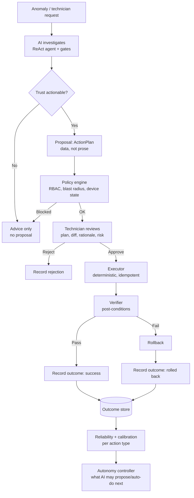

# AI Task Delegation — Approval-Gated Device Actions

> **Status:** Level 2 (approval-gated) — **Phases 0–3, Phase 4, and the § 17
> multi-step roadmap (Phases A–E) are implemented and deployed**. **§ 17.7** is
> the as-built completion matrix; three roadmap items remain open: per-step
> approval gates, per-step retry backoff, and confidence calibration.
> **Goal:** the AI proposes a complete device-management action (or batch); a
> technician reviews and approves it; the system executes deterministically; the
> result is verified and recorded; measured reliability expands what the AI may
> handle over time.
> **Related:** [Agentic AI](ai-agentic.md) | [Trust & Validation Gates](ai-validation-gates.md) | [Provenance & Outcomes](provenance-and-outcomes.md) | [KPI Evaluation Roadmap](kpi-evaluation-roadmap.md) | [Device Configuration (MDM)](device-configuration-mdm.md) | [RBAC Hardening Plan](rbac-hardening-plan.md) | [Audit & Compliance](audit-compliance.md)
>
> **Implemented:** Phases 0–3 are shipped and running in production — the
> proposal layer, trust-gated capture, the review page, the approval API, and the
> deterministic executor with verification and rollback. **§ 5.1** is the
> as-built reference (pipeline, file paths, endpoints, how to try it); § 6–§ 11
> are the original design rationale; § 13 tracks phase status; **§ 17.7** tracks
> the multi-step delegation roadmap (Phases A–E). This document extends the
> "Future Expansion" items already listed
> in [Agentic AI](ai-agentic.md) — *Tool proposal validation* and
> *Human-in-the-loop: technician can approve/reject the agent's proposed
> actions* — into a concrete design.

---

## 1. Why this document

The AI today is read-only: it investigates and **recommends**, and a human does
everything else. The product goal is to **delegate device-management tasks to
the AI**, with a technician kept on the side for final approval. That is a
different class of system: the AI is no longer just answering, it is *proposing
work to be done on real devices*.

The trust architecture already in place (validation gates, a trust envelope, an
audit trail, command plumbing, and outcome columns) gives us most of the
foundation. What is missing is the layer that turns a recommendation into a
**reviewable, executable, reversible action** — and the feedback loop that
proves the recommendation was good. This document defines that layer.

## 2. Goal and autonomy level

This plan targets **Level 2 autonomy — approval-gated execution**:

| Level | Who decides what | Who does it | Who approves |
|---|---|---|---|
| 0 — Read-only | AI answers | — | n/a |
| 1 — Recommend | AI proposes in text | human | — |
| **2 — Delegate (this plan)** | **AI proposes a plan** | **system (deterministic)** | **technician** |
| 3 | AI may auto-run low-risk, reversible actions | system | after the fact |

We deliberately design for Level 2 but structure the data so Level 3 can be
**earned per action type** from measured reliability — never granted globally.

The governing safety rule:

> **The AI never mutates state. It emits a structured, validated *plan*. A
> deterministic executor applies it, after policy checks and technician
> approval.**

The LLM's job shrinks to *propose*. Boring, testable code does the *doing*.

---

## 2.1 The trust triangle

Three pillars, only the first of which exists today:

```
        Explainability            Outcome tracking
        "why this proposal"  +    "was it right?"     =  verifiable trust
              \                         /
               \                       /
                Safe execution layer
                "what we did & how to undo it"
```

- **Explainability** — already partly present: the trust envelope
  (`EnvelopeResult.trust_score`, `passed_gate_ids`, `failed_gate_id`) and cited
  `EvidenceRef`s. This document makes it a first-class part of a proposal.
- **Outcome tracking** — partly present in `configuration_history` and
  `job_outcomes` (see §12); needs to be extended to *proposals*.
- **Safe execution layer** — new. This is the bulk of the work.

Trust for delegation is **empirical**: it is earned by measured outcomes per
action type, not asserted by a gate.

---

## 3. What already exists — build on this, don't rebuild

| Capability | Where | Reuse as |
|---|---|---|
| Trust envelope + `actionable` flag | `ai/gates/envelope.py` (`EnvelopeResult`) | Gating: only `is_actionable` proposals may be approved |
| Gate D (permissions) / Gate E (lifecycle) | `ai/gates/gate_d.py`, `ai/gates/gate_e.py` | Pre-execution policy checks (already sketched in [ai-agentic.md](ai-agentic.md:210)) |
| Agentic ReAct loop | `ai/agent.py` (`run_agent`, `MAX_ITERATIONS=5`, `TOTAL_TIMEOUT=60`) | "Investigate, then propose" — a proposal tool plugs into the existing loop |
| Command queue + permissions | `DeviceCommandsEndpoint.py` (`queue_command`), `command_poller.py` (`COMMAND_TYPES`, `required_permissions_for_command`) | The executor's only mutate path
- **Configuration outcome fields** — `ConfigurationHistory.change_type` already
  supports `'ai_recommended'`, plus `was_successful`, `was_rolled_back`,
  `rollback_reason`, `rollback_success`, `rollback_performance`, `provenance`
  (`backend/src/homepot/app/models/AnalyticsModel.py:211`).
- **Command outcome fields** — `device_commands.sent_at`, `issued_by`
  (`migrations/versions/20260816_add_command_and_config_outcome_tracking.py`).
- **Audit trail** — `homepot.audit` with `AI_QUERY` / `AI_GATE_FAILURE`
  event types and full metadata (`backend/src/homepot/audit.py`).
- **KPIs** — MW-03/04/05 (config success, verified improvement, rollback
  effectiveness) and AI-01…04 (`docs/kpi-evaluation-roadmap.md`).
- **RBAC vocabulary** — `Admin` / `Technician`, `is_privileged`,
  `verify_device_belongs_to_user(..., minimum_role=...)`
  (`backend/src/homepot/app/roles.py`).
- **Simulators** — device emulators + `DeviceSimulatorEndpoint.py`, so first
  execution can run against a simulated fleet.

---

## 4. Scope & non-goals

**In scope**

- A **proposal** object the AI produces (structured, explained, risk-tiered).
- A **policy engine** (RBAC + blast radius + device state) as pre-execution gate.
- A **technician approval** step (UI + audit).
- A **deterministic executor** that reuses the existing command/config paths.
- **Verification + rollback** and **outcome recording**.
- An **autonomy controller** driven by measured reliability.

**Non-goals (for now)**

- Fully autonomous (no-approval) actions — that is Level 3+, gated on data.
- New device capabilities — the executor can only do what the agent already can
  (`COMMAND_TYPES`).
- Replacing the technician or the existing command UI.
- Multi-agent planning / model upgrade (that is [Agentic AI](ai-agentic.md)
  Tier 2/3).

---

## 5. System flow



The key property: **the AI can only ever hand off a plan.** Nothing between the
proposal and the executor is LLM-generated.

---

## 5.1 Implemented end-to-end (Phases 0–3)

This is the **as-built** reference for the "AI Proposals" feature: what runs
today, where it lives, and how to exercise it. The design rationale is in § 1–§
12; the file paths below are the ground truth.

### Where a proposal comes from

1. A technician (or agent) asks the AI a question through the agentic query
   endpoint (`POST /ai/query` with `"agentic": true`). The ReAct agent
   investigates with its read-only tools (`ai/agent.py`) and, if it concludes an
   action is warranted, calls the `propose_device_action` tool.
2. That tool **never executes anything**. It validates the proposal against the
   allowlist (`ai/actions.py::validate_proposal` — unknown action, missing
   target id or missing required params are rejected) and pushes a validated
   `ActionProposal` into a per-run ContextVar sink.
3. `run_agent` returns them on `AgentResult.proposals`.
4. `AIEndpoint.py` surfaces proposals **only if** the trust envelope marks the
   answer *actionable* **and** the agent run completed normally (a direct-LLM
   fallback never yields approvable actions) — see `AIEndpoint.py:1067`.
5. For surfaced proposals, `AIActionRepository.create_plan` persists an
   `ai_action_plan` + `ai_action_step` rows with status **`pending_approval`**,
   carrying the risk tier (`max_risk_tier`), `reversible` (`all_reversible`),
   rationale, evidence, and the trust envelope (`trust_mode`, `trust_score`,
   `passed_gates`, `failed_gate`). Capture is audited (`AI_PROPOSAL_CREATED`)
   and returned to the caller in a `proposal` block.

If the answer is not actionable the AI still answers in prose, but no plan is
created and nothing appears on the review page.

### Validation envelope (why a proposal is trustworthy)

Proposals only exist downstream of the ordered gate chain
(`ai/gates/envelope.py`; first failure wins): **A** infrastructure/schema, **B**
data integrity, **C** context readiness, **D** permission/capability, **E**
lifecycle. The first failing gate sets a non-actionable Mode and a
`failed_gate_id` (e.g. `"C (post-insight)"`). The resulting `trust_score`,
`passed_gate_ids` and `failed_gate` are copied onto the plan and shown in the UI.

### Review UI — `/ai-proposals` ("AI Proposals" in the sidebar)

`frontend/src/pages/AIProposals/AIProposalsList.jsx`. Default filter is **Pending
Approval**; other filters: All, Approved, Executing, Succeeded, Failed, Rolled
Back, Rejected, Blocked. Each card shows the status badge, risk tier, reversible
flag, rationale, the steps (`action → target_device`), the outcome line once
finished, target devices, and the trust score/mode. Buttons are status-driven:

* `pending_approval` → **Approve** / **Reject**
* `approved` → **Execute**
* any terminal status → no buttons

### Approval & execution API (`AIActionEndpoint.py`, mounted under `/api/v1/ai`)

| Method & path | Purpose | Guard |
|---|---|---|
| `GET /action-plans` | list plans, newest first | auth; filtered to the caller's accessible devices |
| `GET /action-plans/{id}` | one plan | auth; `404` if any target is outside scope |
| `POST /action-plans/{id}/approve` | record an approval (**no execution**) | `pending_approval` only (else `409`); operator on every target device |
| `POST /action-plans/{id}/reject` | record a rejection + optional reason | same |
| `POST /action-plans/{id}/execute` | hand an approved plan to the executor | `approved` only (atomic claim, else `409`) |

Every decision is scope-checked with
`verify_device_belongs_to_user(..., minimum_role="operator")` (admins bypass) and
audited (`AI_PROPOSAL_APPROVED` / `AI_PROPOSAL_REJECTED`). Approving does **not**
run anything — execution is a deliberate second action.

### Execution pipeline

`POST .../execute`:

1. `claim_for_execution` atomically moves `approved → executing` so two requests
   cannot both run it.
2. `executor.start_execution` re-runs **policy** against live data
   (`ai_ops/policy.py`): the action must be declared; its tier must be `T1`/`T2`;
   every target device must exist and be `active`; the required permission
   (`root_access`) must be granted; and the plan must target at most
   `MAX_DEVICES_PER_PLAN` (5) devices. If policy blocks, the plan is recorded
   `blocked` and the response carries the reasons — nothing is queued.
3. On success the executor queues one `DeviceCommand` per step through the
   **same command path the operator UI uses** (single audited mutate path),
   snapshots the config needed for rollback, marks the steps `queued`, and
   returns immediately — execution is asynchronous.
4. A background reconcile loop (`ai_ops/reconcile.py`, every 10 s) advances
   in-flight plans via `ai_ops/verifier.py`: it maps each command's status onto
   its step (`pending→queued`, `sent→running`, `completed→done`,
   `failed`/`expired`/`cancelled`→`failed`), treats per-key `update_config`
   failures reported inside a "completed" result as failures, and when every step
   is `done` records the outcome and sets `succeeded`.
5. On any step failure it enters **rollback** (`ai_ops/rollback.py`): reversible
   applied steps are undone in reverse order — `update_config` queues the inverse
   using the snapshotted `previous` values; `restart` is self-reverting and is
   marked `rolled_back` immediately. The verifier confirms the inverse commands
   and sets `rolled_back` (success) or `failed` (a rollback command itself
   failed).
6. Exactly one `AIActionOutcome` is written per terminal plan
   (`verified` / `rolled_back` / `rollback_success` / `error` / `provenance`) —
   the empirical evidence future autonomy decisions are earned from.

State machine as implemented: `pending_approval → approved → executing →
succeeded | rolling_back → rolled_back | failed`, plus `blocked`, `rejected`
and `expired`.

### Audit events (`homepot/audit.py`)

`ai_proposal_created`, `ai_proposal_approved`, `ai_proposal_rejected`,
`ai_execution_started`, `ai_execution_blocked`, `ai_execution_succeeded`,
`ai_execution_failed`, `ai_execution_rolled_back` — alongside the pre-existing
`ai_query` and `ai_gate_failure`.

### Runtime wiring & deployment

The reconcile loop must run in the process that **serves the API**
(`homepot.app.main:app`) — the app the `homepot-api` systemd service and the
Docker image launch. It is started and cancelled by the startup/shutdown hooks in
`backend/src/homepot/app/main.py`. This is called out because the loop
previously lived only in the legacy `homepot.main` module, which the deployed
service never imports, so the verifier never ran in production and plans stuck
in `executing`. **PR #508** extracted it to `ai_ops/reconcile.py` and wired the
served app into it; a regression test
(`test_served_app_starts_ai_reconcile_loop`) guards the wiring.

The review page is a client-side route (`/ai-proposals`); behind the production
Apache vhost it relies on the SPA history fallback
(`frontend/public/.htaccess`, **PR #510**) so deep links and refreshes resolve to
the app instead of a `404`.

### How to try it

Ask the AI (agentic mode, with the target device's telemetry fresh and its
`root_access` granted) something that warrants an action — e.g. *"&lt;device&gt;
looks offline, restart it"*. If every gate passes and the run is healthy the plan
appears under **AI Proposals** as *Pending Approval*; then Approve → Execute and
watch *Executing* → *Succeeded* (or a rollback). v1 is deliberately limited to
`update_config` and `restart` (both **T2**, reversible) on a single device.

---

## 6. Proposal lifecycle

An `ActionPlan` moves through an explicit state machine; every transition is
audited.

| State | Meaning | Who moves it |
|---|---|---|
| `proposed` | AI produced a plan, policy check pending | system |
| `blocked` | Policy engine rejected (RBAC/state/blast radius) | system |
| `pending_approval` | Policy passed; waiting on a technician | system |
| `approved` / `rejected` | Technician decision recorded | technician |
| `executing` | Executor running steps | system |
| `succeeded` | All steps verified | system |
| `rolling_back` | A step failed; undoing reversible steps | system |
| `failed` | A step (or rollback) failed and could not be undone | system |
| `rolled_back` | Reverted to pre-action state | system |
| `expired` | Not approved within a window | system |

Terminal: `succeeded`, `failed`, `rolled_back`, `rejected`, `expired`, `blocked`.

---

## 7. Components & where they live

| Component | Location | Responsibility |
|---|---|---|
| **Proposal tool** | `ai/tools.py` (`propose_device_action`) + `ai/actions.py` | Validates a model proposal against the allowlist and records it in a per-run sink; never executes |
| **Action registry** | `ai/actions.py` | Declares each capability + risk tier + reversibility + required permission (v1: `update_config`, `restart`, both T2) |
| **`ai_ops` service** | `backend/src/homepot/app/ai_ops/` | policy, executor, verifier, rollback, reconcile loop |
| **Registry bridge** | `ai_ops/registry.py` | Re-exposes `ai/actions.py` to the backend (one source of truth, no drift) |
| **Policy engine** | `ai_ops/policy.py` | Declared action; tier `T1`/`T2`; device `active`; required permission granted; blast radius ≤ 5 devices |
| **Executor** | `ai_ops/executor.py` | Deterministic; queues one command per step via the **same** path as the UI; snapshots state for rollback |
| **Verifier** | `ai_ops/verifier.py` | Maps command results onto steps; writes the single `AIActionOutcome` |
| **Rollback** | `ai_ops/rollback.py` | Inverse `update_config` (snapshot) / self-reverting `restart` |
| **Reconcile loop** | `ai_ops/reconcile.py` | Background driver (10 s); started/cancelled by `homepot/app/main.py` |
| **API** | `backend/src/homepot/app/api/API_v1/Endpoints/AIActionEndpoint.py` (under `/api/v1/ai`) | `GET /action-plans`, `GET /action-plans/{id}`, `POST /action-plans/{id}/approve`, `/reject`, `/execute` |
| **Data model** | `AnalyticsModel.py` + migration `20261016_add_ai_action_tables` | `ai_action_plan`, `ai_action_step`, `ai_approval`, `ai_outcome` |
| **Metrics** | `ai/analytics_service.py`, `ai_ops/autonomy.py` | Per-action-type reliability from `ai_outcome` (Phase 4/14) + autonomy ladder (Phase D/16); confidence calibration still open (§ 17.7) |
| **UI** | `frontend/src/pages/AIProposals/AIProposalsList.jsx` | Review queue: status, target(s), rationale, risk, steps, approve/reject/execute, outcome |

Design rule: the executor must **reuse `DeviceCommandsEndpoint` /
`AgentConfigHistoryEndpoint` behaviour, not re-implement it**, so there is a
single audited path to every device.

---

## 8. Data model (new tables)

```text
ai_action_plan
  plan_id            uuid pk
  created_at         timestamptz
  source_query_id    uuid        -- links to the AI query / audit event
  trust_mode         text        -- from EnvelopeResult
  trust_score        float
  passed_gates       jsonb       -- e.g. ["A","B","C","D","E","C"]
  failed_gate        text null
  risk_tier          text        -- T1..T4 (see §9)
  status             text        -- §6 state machine
  rationale          text        -- human-readable "why"
  evidence           jsonb       -- list of EvidenceRef
  reversible         boolean
  created_by         text        -- user id/email

ai_action_step
  step_id            uuid pk
  plan_id            uuid fk
  seq                int
  action             text        -- e.g. "update_config", "restart"
  target_device_id   text
  params             jsonb
  preconditions      jsonb
  postconditions     jsonb       -- how the verifier checks success
  rollback_params    jsonb null
  status             text        -- pending/running/done/failed/skipped
  command_id         text null   -- links to device_commands

ai_approval
  approval_id        uuid pk
  plan_id            uuid fk
  actor              text        -- technician id/email
  decision           text        -- approved/rejected
  reason             text null
  decided_at         timestamptz
  device_scope       jsonb       -- what scope the actor was allowed to approve

ai_outcome
  outcome_id         uuid pk
  plan_id            uuid fk
  verified           boolean
  metrics_before     jsonb
  metrics_after      jsonb
  rolled_back        boolean
  rollback_success   boolean null
  error              text null
  recorded_at        timestamptz
  provenance         text        -- real/controlled/simulated
```

Where an outcome is a configuration change, we continue to write
`configuration_history` (with `change_type='ai_recommended'`) so existing KPIs
(MW-03/04/05) work unchanged; `ai_outcome` adds the proposal-level link.

---

## 9. Action registry & risk tiers

Each capability is declared, with the data that drives policy and approval:

| Tier | Example actions | Reversible | Approval |
|---|---|---|---|
| **T1** read-only | diagnostics, `health_check`, `ping`, `status_request` | n/a | none |
| **T2** reversible | `update_config` (with snapshot), `restart` | yes | technician |
| **T3** disruptive | `run_script`, fleet-wide config rollout | maybe | senior / batch approval |
| **T4** destructive | `shutdown`, wipe/lock | no | out of scope for v1 |

v1 is deliberately limited to **T2 on a single device against the simulator**.

Registry entry sketch:

```python
ActionSpec(
    name="update_config",
    command_type="update_config",          # must exist in COMMAND_TYPES
    risk_tier="T2",
    reversible=True,
    required_permission="root_access",     # from REQUIRED_PERMISSION
    min_role="operator",
    preconditions=["device ACTIVE", "device online", "snapshot available"],
    postconditions=["config applied", "health still OK"],
    rollback="restore snapshot",
)
```

---

## 10. Approval & RBAC

- Approval is a **privileged action** and must be **role- and scope-checked**:
  a technician may only approve actions for devices/sites they belong to. Use
  `verify_device_belongs_to_user(db_user, device, sync_db, minimum_role="operator")`
  (as the command endpoint already does), **not** a bare admin check.
- **Important caveat:** `HOMEPOT_DEV_UNIFIED_ACCESS` currently defaults to `True`
  (`roles.py`), so `is_privileged()` returns `True` for everyone during
  development. The approval gate must therefore key off device membership +
  minimum role, and be validated against the [RBAC Hardening Plan](rbac-hardening-plan.md)
  before production. The plan's DoD — *"every privileged action records its
  actor"* — is a hard prerequisite for this feature.
- Approval may be **per-action** (v1) or **per-plan/batch** (later). Batch
  approval requires a **blast-radius policy** (max devices, max sites) and a
  dry-run diff for the whole batch.

---

## 11. Explainability surface

What the technician sees before approving — the three moments:

1. **At proposal:** plan summary, per-step target(s), config **diff**, rationale,
   cited evidence, which gates passed, trust score, risk tier, and reversibility
   / rollback plan.
2. **At decision:** a **dry-run preview** (what would change, validated against
   the simulator or a read-only diff), so approval is informed.
3. **Post-hoc:** the audit trail + `ai_outcome` record, plus the track record for
   that action type ("`update_config` succeeded 47/50 times, avg verify 12s").

Explainability without outcome tracking is a plausible story. Explainability
**plus** outcomes is verifiable trust.

---

## 12. Outcome tracking & metrics

Outcomes come from two sources, both recorded per proposal:

- **Automatic** — the verifier's post-condition results + telemetry
  (`metrics_before` / `metrics_after`).
- **Human** — the technician's post-hoc confirmation (fixed / not fixed, notes).

Metrics (extend `ai/analytics_service.py`), per action type:

| Metric | Definition | Reuse |
|---|---|---|
| Proposal acceptance rate | approved / proposed | new |
| Execution success rate | succeeded / executed | MW-03 |
| Verified improvement | improvement after change | MW-04 |
| Rollback effectiveness | successful rollbacks / attempted | MW-05 |
| Time to resolve | detect → verified | MW-06/MW-07 |
| **Confidence calibration** | does `trust_score=0.9` → ~90% success? | AI-01…04 |

The autonomy controller reads these to decide what the AI may propose or (later)
auto-execute. Advancing an action type to the next autonomy level requires a
sample size and success bar agreed up front.

---

## 13. Phased roadmap

| Phase | Deliverable | Exit criteria | Guardrail |
|---|---|---|---|
| **0** | Delegation data model: models + migration + tests (no endpoints/LLM) | four `ai_*` tables exist; models persist and cascade; no execution | read-only |
| **1** | Proposal layer + explainability fields | AI emits a structured `ActionPlan` with rationale/evidence/gates; **dry-run only** | no execution |
| **2** | Approval UI + audit + RBAC scoping | technicians see and approve/reject; actor + scope recorded | human decides |
| **3** | Executor for **one** T2 action vs **simulated** devices, with verify + rollback | one action type end-to-end on the emulator; rollback proven | single action, T2, sim |
| **4** | Expand action set + autonomy controller | multiple T2 actions; autonomy level driven by measured reliability | metrics gate scope |

**Phase 0 status: implemented.** `AIActionPlan`, `AIActionStep`,
`AIActionApproval`, and `AIActionOutcome` live in
`backend/src/homepot/app/models/AnalyticsModel.py`; migration
`20261016_add_ai_action_tables` creates the schema (idempotently, since the app
also builds it via `Base.metadata.create_all`); tests are in
`backend/tests/test_ai_action_models.py`. No endpoint or agent touched these
tables at Phase 0 — **capture wiring landed with the producers in Phases 1–3**
(see § 5.1); reliability metrics and the autonomy controller landed with Phase 4
(§ 17.7).

Phases 0–2 are ordinary backend/DB/UI work; only phases 1 and 3 touch the AI.
That is why this goal is achievable.

**Phase 1 status: implemented (proposal-only / dry-run).** The action registry
`ai/actions.py` declares the v1 capabilities (`update_config`, `restart`, both
**T2**, reversible, `root_access`) and validates model output against it; the
agent gains a `propose_device_action` tool that records validated proposals in a
per-run ContextVar sink (never executes); `run_agent` returns them on
`AgentResult.proposals`; and the agentic `/ai/query` branch persists them to
`ai_action_plan`/`ai_action_step` (status `proposed`) via
`AIActionRepository`, returning a `proposal` block. Proposals are surfaced only
when the trust envelope is actionable and the agent completed normally (not a
direct fallback). There is **no execution path** yet — approval (Phase 2) and
the executor (Phase 3) are still to come. Tests live in
`backend/tests/test_ai_delegation_phase1.py` and
`backend/tests/test_ai_agent.py`.

**Phase 2 status: implemented (approval-only / human-in-the-loop).** Captured
plans are now persisted with status `pending_approval` (the promotion from
`proposed` when the trust envelope is actionable), and a new `AIActionEndpoint`
exposes `GET /ai/action-plans`, `GET /ai/action-plans/{plan_id}`,
`POST /action-plans/{plan_id}/approve` and `/reject`. Decisions are **per-plan**
(matching `AIActionApproval.plan_id`), scoped with
`verify_device_belongs_to_user(..., minimum_role="operator")` (admins bypass;
lists are filtered to accessible devices), and audited via
`AI_PROPOSAL_APPROVED`/`AI_PROPOSAL_REJECTED` (`AI_PROPOSAL_CREATED` on
capture). Only `pending_approval` plans are reviewable; terminal plans return
`409`. Decisions record the actor in `ai_approval` but **do not execute**
— that is Phase 3. A minimal frontend review page (`/ai-proposals`, "AI
Proposals" in the sidebar) lists plans and approves/rejects them. Backend tests:
`backend/tests/test_ai_action_approval.py`; frontend test:
`frontend/tests/unit/AIProposalsList.test.jsx`.

**Phase 3 status: implemented (deterministic executor + verify + rollback).**
The new `homepot.app.ai_ops` package holds the execution layer:
`policy.py` re-checks live data (declared action, tier in T1/T2, device
`active`, `root_access` granted, blast radius ≤ 5) before anything runs;
`executor.py` queues one `DeviceCommand` per step through the same command path
the operator UI uses and snapshots each `update_config` so it can be undone;
`rollback.py` queues inverse `update_config` commands (and treats `restart` as
self-reverting); `verifier.py` advances a plan as device results arrive and
writes exactly one `AIActionOutcome`. `POST /ai/action-plans/{plan_id}/execute`
(only `approved` plans; a policy failure records status `blocked` and returns
`200` with a `policy` block) kicks the plan into `executing`, and a background
reconcile loop (`ai_ops/reconcile.py`, started by the served
`homepot/app/main.py`) finalises it to `succeeded` / `rolled_back` / `failed`.
New audit events: `AI_EXECUTION_STARTED`/`BLOCKED`/`SUCCEEDED`/
`FAILED`/`ROLLED_BACK`. The `/ai-proposals` page gains an **Execute** button for
approved plans and an outcome line. Backend tests:
`backend/tests/test_ai_execution.py`.

The reconcile loop originally lived only in the legacy `homepot.main` module
(which the deployed service never imports), so it never ran in production and
plans stuck in `executing`. **PR #508** extracted it to `ai_ops/reconcile.py`
and wired it into the served app, guarded by the
`test_served_app_starts_ai_reconcile_loop` regression test. Phases 0–3 plus that
fix and the hardening work merged in PRs #503–#508 and are deployed; § 5.1 is the
as-built reference.

**Phase 4 status: implemented (metrics + autonomy scaffolding).**
`ai/analytics_service.py::get_ai_action_reliability` computes per-action-type
proposal acceptance, execution success, verified improvement, and rollback
rates from `ai_outcome`/`ai_action_plan`; `homepot.app.ai_ops.autonomy.py`
defines the level 0–3 ladder (level 2 at ≥ 50 samples / ≥ 98 % success, level 3
at ≥ 200 samples / ≥ 99.5 % plus a proven rollback); outcomes feed long-term
device memory (`_record_outcome` → `DeviceMemory`); and the AI Proposals page
gained the reliability/task-aggregation panel (`AIReliabilityPanel`). Known
limits are tracked in § 17.7: the autonomy controller is not yet hydrated from
reliability or consulted before execution, and confidence calibration is not
implemented.

---

## 14. Open decisions (need sign-off before Phase 1)

1. **Initial action list + risk tiers** — proposed: `update_config` (T2) and
   `restart` (T2) only; everything else deferred.
2. **Approval matrix** — proposed: `Technician` approves T2 for their own
   devices/sites; T3 requires `Admin`.
3. **Batch approval** — v1 per-action, or per-plan? Proposed: per-action first.
4. **Autonomy bar** — required sample size + success rate before any action type
   may run without approval. Proposed: ≥ 50 verified runs, ≥ 98% success, rollback
   proven.
5. **Maintenance windows** — are approvals always allowed, or restricted to
   site operating schedules (`SiteOperatingSchedule`)?

---

## 15. Risks

| Risk | Impact | Mitigation |
|---|---|---|
| Wrong action at scale | Fleet-wide breakage | start single-device/simulated; blast-radius policy |
| Prompt injection via tool output triggers a proposal | Unauthorised change | executor + policy engine are the enforcer, not the prompt; human approval |
| Non-deterministic plans | Unpredictable behaviour | validate proposal against registry; reject unknown actions |
| Partial failure mid-batch | Inconsistent state | idempotent steps; per-step rollback |
| RBAC not production-ready | Wrong actor can approve | membership-scoped approval; RBAC plan DoD as prerequisite |
| 3B model unreliable for planning | Bad proposals | human approval absorbs it; stronger planner model later |

---

## 17. Multi-step task delegation — gaps and roadmap

> **Status:** Phases A–E implemented and deployed — see **§ 17.7** for the
> as-built completion matrix and the items that remain open. Before Phase A,
> Phases 0–3 (§ 5.1) were single-step and human-driven: one action per plan, one
> approval, one execution. This section documents the gap to **multi-step task
> delegation** — where the AI proposes a complete workflow (investigate →
> diagnose → act → verify), executes it step by step after approval, and adapts
> based on intermediate results — and the phased roadmap that closed it.

### 17.1 What "multi-step task delegation" means

Today the AI can propose **one action** (e.g. `update_config` or `restart`) on
**one device**. A technician approves it, the executor runs it, and the verifier
checks the outcome. This is a single-step, single-device, fire-and-forget
action.

Multi-step task delegation means the AI proposes a **task** — a directed graph
of steps with dependencies — and the system executes it autonomously within the
approved scope, verifying each step before proceeding to the next. Examples:

- "Device X has high CPU → check processes → if a runaway process is found, kill
  it → verify CPU drops → if not resolved, restart the device → verify recovery"
- "Fleet-wide config rollout → update 5 devices in maintenance window → verify
  each → rollback any that fail"
- "Diagnose offline device → check network → if network is fine, check agent
  health → if agent crashed, restart agent → verify reconnection"

### 17.2 What already exists (Phases 0–3)

> **Baseline snapshot.** This table records what existed *before* Phase A. The
> "need …" entries in the third column were the work Phases A–E set out to do;
> see § 17.7 for what landed.

| Capability | Location | Reuse for multi-step |
|---|---|---|
| Proposal tool + registry | `ai/tools.py`, `ai/actions.py` | Registry declares capabilities; needs expansion (§ 17.4) |
| Trust envelope + gates A–E | `ai/gates/envelope.py` | Gates run once per query; need per-step coverage (§ 17.5) |
| Agentic ReAct loop | `ai/agent.py` (5 iter, 60 s) | Planning mode needs to be added (§ 17.4) |
| Action plan + steps (DB) | `AnalyticsModel.py`, migration `20261016` | `ai_action_step` has `preconditions`/`postconditions`/`seq` but they are **never evaluated** |
| Policy engine | `ai_ops/policy.py` | Re-checks live data; needs inter-step precondition evaluation |
| Executor | `ai_ops/executor.py` | Dispatches all steps in one pass; needs dependency-aware sequential dispatch |
| Verifier + reconcile | `ai_ops/verifier.py`, `reconcile.py` | Advances steps; needs step-gating (step N waits for step N-1) |
| Rollback | `ai_ops/rollback.py` | Undoes reversible steps; needs per-step rollback, not all-or-nothing |
| Investigation sessions | `InvestigationEndpoint.py`, `investigation_events.py` | Status-only runs; no step list or checkpoint |
| Outcome store | `ai_outcome` table | Records one outcome per plan; no per-step outcomes |
| Audit trail | `homepot/audit.py` | Covers proposals; needs per-step audit events |
| RBAC | `roles.py`, `auth_utils.py` | Approval scoped by device membership; tools need per-device RBAC |

### 17.3 Gaps

> **Pre-implementation snapshot.** G1–G12 drove Phases A–E. Closed by the
> implementation: G1, G2, G5, G6, G8–G10, G12. Partially closed: G3 (no
> fleet-wide actions), G4 (lightweight integrity annotation only), G7 (autonomy
> controller not wired), G11 (configurable but defaults unchanged). See § 17.7.

| # | Gap | Current state | Impact on delegation |
|---|-----|--------------|----------------------|
| G1 | **Task model beyond single query** — no durable, resumable multi-step task with dependencies | `InvestigationRun` is status-only (pending/running/completed); `ai_action_plan` has `seq` but no dependency edges | Cannot orchestrate "investigate → propose → execute → verify" as one unit |
| G2 | **Sequential/conditional execution** — steps dispatched together, no dependency edges or preconditions | `executor.py` loops over all steps and queues commands in one pass; `preconditions`/`postconditions` columns exist but are never evaluated | Out-of-order or unsafe execution; partial failures not handled gracefully |
| G3 | **Action registry breadth** — only 2 T2 device actions (`update_config`, `restart`) | `ai/actions.py` declares only 2 capabilities | Cannot express verification, health checks, fleet actions, or T3 disruptive actions |
| G4 | **Gate coverage on tools/steps** — gates run once per query; tool I/O and per-step state unvalidated | `build_envelope` runs once on assembled context; tool outputs fed directly to LLM | Untrusted intermediate data; unsafe autonomy |
| G5 | **Per-device RBAC in tools** — tools accept any `device_id` | `ai/tools.py` functions accept `device_id` without checking caller scope | Authorization bypass risk in delegated tasks |
| G6 | **Outcome-driven feedback** — outcomes recorded but not consumed by memory/prompts/analytics | `AIActionOutcome` written but not read back | No learning; autonomy cannot be earned |
| G7 | **Reliability metrics + autonomy controller** — Phase 4 is design-only | `analytics_service.py` has no per-action-type reliability; no autonomy controller exists | No empirical trust; all actions require approval |
| G8 | **Durability of runs** — in-memory event bus, no checkpointing | `investigation_events.py` uses in-memory per-run replay buffer + live queues | Long-running multi-step tasks lost on process restart |
| G9 | **Scheduling/maintenance windows** — computed but unused | `analytics_service.py::get_optimal_scheduling_windows` exists but executor ignores `SiteOperatingSchedule` | Cannot defer tasks to safe windows |
| G10 | **Mid-execution checkpoints / cancellation** — all-or-nothing approval; no cancel of executing plan | No `cancel_task` API; no checkpoint after each step | Poor operator control over long-running tasks |
| G11 | **Agent depth** — 5 iterations / 60 s, no plan-and-execute mode | `MAX_ITERATIONS=5`, `TOTAL_TIMEOUT_SECONDS=60` | Complex tasks truncated on CPU host |
| G12 | **Plan status query tool** — agent cannot await its own proposed action's outcome | No tool to query plan status or await an action outcome | Cannot close the delegation loop |

### 17.4 Roadmap

#### Phase A — Task model & orchestration (foundation)

**Goal:** A durable, resumable multi-step task that links investigation runs → plans → outcomes.

1. **Task graph model** — Add a `Task` (or extend `InvestigationRun`) with an ordered step list, dependency edges, and per-step status. Persist to DB (not in-memory). Reuse `ai_action_step.seq` and add `depends_on_step_id`.
2. **Dependency-aware sequential execution** — Executor dispatches step N only after step N-1 succeeds. Evaluate `preconditions`/`postconditions` (columns exist but unused).
3. **Mid-flight checkpoints & cancellation** — Add `cancel_task` API. Save checkpoint after each step so a restart resumes mid-flight.
4. **Per-step approval gates** — Allow "approve step 1, review, then approve step 2" instead of all-or-nothing.

#### Phase B — Broader action registry & tooling

**Goal:** The AI can express richer multi-step tasks.

5. **Expand action registry** — Add T1 (read-only: `health_check`, `list_processes`, `scan_filesystem`), T3 (disruptive: `restart_service`, `rollback_config`), fleet-wide actions, and verification steps.
6. **Plan status query tool** — Let the agent query "did my proposed action succeed?" and close the delegation loop.
7. **Plan-and-execute agent mode** — First draft a plan (no tool calls), then execute steps sequentially. Separate planning from execution.
8. **Per-device RBAC in tools** — Enforce `verify_device_belongs_to_user` inside each tool, not just at the endpoint.
9. **Gate coverage on tool I/O** — Run Gate B (data integrity) on tool outputs before feeding back to the LLM.

#### Phase C — Scheduling & safety

**Goal:** Tasks run at the right time with proper guardrails.

10. **Maintenance window integration** — Executor checks `SiteOperatingSchedule` before dispatching disruptive steps.
11. **Dry-run / simulation preview** — Before approval, show "what would happen" using the simulator for non-destructive validation.
12. **Idempotency keys** — Prevent duplicate execution on retry.
13. **Retry policy** — Per-step retry with backoff; on failure, try alternative or escalate (not just rollback everything).

#### Phase D — Outcome-driven autonomy (Phase 4 extension)

**Goal:** Earn autonomy through measured reliability.

14. **Reliability metrics** — Per-action-type: proposal acceptance rate, execution success, verified improvement, rollback effectiveness. Store in DB.
15. **Confidence calibration** — Compare trust score vs. actual success rate. Adjust autonomy thresholds.
16. **Autonomy controller** — Level 0 (suggest) → Level 1 (propose, human approves) → Level 2 (execute if trust ≥ threshold) → Level 3 (auto-execute for proven-safe actions).
17. **Feedback to memory/prompts** — Feed outcomes back into long-term memory so the AI learns from past successes/failures.
18. **Analytics dashboard** — Expose reliability metrics to operators so they can see what the AI is doing and how well.

#### Phase E — Depth & scale

**Goal:** Handle complex, multi-device tasks.

19. **Parallel tool calls** — Correlate across devices faster.
20. **Extended agent timeout / deeper iterations** — For complex tasks on CPU hosts (or use cloud providers for planning).
21. **Cross-session task aggregation** — "Show me all tasks I've delegated and their status."

### 17.5 Recommended starting point

> **Historical (pre-Phase-A).** All three starting points below have since
> landed; § 17.7 records the remaining work.

Given the current foundation, the highest-impact next steps are:

1. **Phase A (G1–G4)** — This is the core gap. Without a durable task graph, nothing else matters. The `InvestigationRun` model and event bus exist but lack step-level detail. `ai_action_step.preconditions`/`postconditions` columns exist but are never evaluated.
2. **Phase B (G3, G12)** — Expanding the action registry and adding a plan-status query tool closes the delegation loop. The agent can propose → execute → check outcome.
3. **Phase D (G6, G7)** — Even without full autonomy, measuring reliability is essential for deciding what to delegate.

### 17.6 What you can do today (no new code)

The system already supports a **manual delegation loop**:
1. Ask AI: "Device X has high CPU — what should I do?" → AI proposes `update_config` or `restart`
2. Approve the proposal → Executor queues the command
3. Verify the outcome → Check device metrics after
4. If it worked, the memory system records it for future reference

The manual loop remains the safe default; Phases A–E add the multi-step,
dependency-aware path described in § 17.7, with approval still required unless an
action type earns autonomy.

### 17.7 Implementation status (as built, November 2026)

Phases A–E are merged and deployed (PRs #751–#757). This matrix maps every
roadmap item to its as-built location. Legend: **Done** = implemented,
**Partial** = partially implemented, **Open** = not implemented.

| # | Item | Status | Where |
|---|---|---|---|
| A1 | Task graph model (`depends_on_step_id`) | Done | migration `20261103_add_step_dependencies_to_action_step`; `AIActionStep` model |
| A2 | Dependency-aware execution + pre/postconditions | Done | `ai_ops/executor.py` (`_is_step_ready`, `dispatch_ready_steps`), `ai_ops/policy.py` (`_evaluate_preconditions`), `ai_ops/verifier.py` (`_evaluate_postconditions`) |
| A3 | Checkpoints & cancellation | Done | `POST /ai/action-plans/{id}/cancel`; step state in DB + `ai_ops/reconcile.py` resumes `executing` plans |
| A4 | Per-step approval gates | Open | `ai_action_step.approval_required` and the `executor.py` gate exist, but nothing sets the flag and there is no step-level approve API/UI — a gated step would wait forever |
| B5 | Registry breadth | Partial | `ai/actions.py`: T1 `health_check`/`list_processes`/`scan_filesystem`, T2 `rollback_config`, T3 `restart_service`; **no fleet-wide actions** |
| B6 | Plan status query tool | Done | `ai/tools.py::get_action_plan_status` |
| B7 | Plan-and-execute agent mode | Done | `ai/agent.py` (`plan_and_execute`, `_parse_plan`) |
| B8 | Per-device RBAC in tools | Done | `ai/tools.py::_check_device_access` |
| B9 | Gate B on tool I/O | Partial | `ai/agent.py` annotates empty/error tool output; the full `DataIntegrityGate` is not applied |
| C10 | Maintenance-window integration | Done | `ai_ops/policy.py::is_maintenance_window`; deferred steps re-checked in `verifier.py` |
| C11 | Dry-run / simulation preview | Partial | `POST /ai/action-plans/{id}/dry-run`; no UI control and no simulator integration |
| C12 | Idempotency keys | Done | `ai_action_step.idempotency_key` → `create_device_command`; migration `20261103_add_idempotency_to_device_command` |
| C13 | Retry with backoff | Open | `retry_count`/`max_retries`/`next_retry_at` plumbing exists, but steps are created with `max_retries=0` and no future `next_retry_at` is scheduled — retries never fire; no alternative/escalation |
| D14 | Reliability metrics | Done | `ai/analytics_service.py::get_ai_action_reliability` |
| D15 | Confidence calibration | Open | Not implemented; gate constants remain paper-informed |
| D16 | Autonomy controller | Partial | `ai_ops/autonomy.py` (levels 0–3); not hydrated from reliability and not consulted before execution, so `GET /ai/autonomy` returns `{}` |
| D17 | Outcome feedback to memory | Done | `ai_ops/verifier.py::_record_outcome` → `DeviceMemory` |
| D18 | Analytics dashboard | Done | `frontend/src/pages/AIProposals/AIReliabilityPanel.jsx` |
| E19 | Parallel tool calls | Done | `ai/agent.py` (`asyncio.gather`) |
| E20 | Extended timeout / deeper iterations | Partial | Configurable via `ai/config.yaml` `agent:` and `run_agent` params; shipped defaults remain 5 iterations / 60 s |
| E21 | Cross-session task aggregation | Done | `GET /ai/action-plans/summary`, `AIActionRepository.plan_summary`, UI panel |

**Remaining work:**

1. **A4 per-step approval** — add
   `POST /action-plans/{id}/steps/{step_id}/approve` (+ UI), or remove the
   dormant `approval_required` path and document per-plan approval only.
2. **C13 retry** — set a non-zero `max_retries` when plans are created, schedule
   a future `next_retry_at` (exponential backoff), and define the
   alternative/escalation path.
3. **D16 autonomy wiring** — hydrate the controller from
   `get_ai_action_reliability` at startup/refresh and consult
   `check_autonomy()` in the approve/execute path.
4. **D15 calibration** — compare `AIActionPlan.trust_score` with the observed
   success rate and adjust thresholds.
5. **B5 fleet actions** — add fleet-scoped actions to `ai/actions.py`.
6. **B9/C11** — apply the real `DataIntegrityGate` to tool output; surface
   dry-run in the UI and wire the simulator.

**Test coverage.** Phases A–E shipped with **no new backend tests** (only minor
edits to `test_ai_execution.py`/`test_ai_agent.py`); the only new tests are the
four frontend `AIReliabilityPanel` tests. A follow-up test suite should cover:
dependency ordering and cycle rejection, preconditions/postconditions,
maintenance-window deferral, retry/backoff, idempotency, autonomy thresholds,
reliability/summary endpoints, cancel, dry-run, plan-and-execute, and tool RBAC.

---

## 16. References

- [Agentic AI](ai-agentic.md) — ReAct loop, tools, and the future-expansion
  items this document develops.
- [Trust & Validation Gates](ai-validation-gates.md) — `trust_score`,
  `actionable`, Gate D/E semantics.
- [Provenance & Outcomes](provenance-and-outcomes.md) and
  [KPI Evaluation Roadmap](kpi-evaluation-roadmap.md) — existing outcome fields
  and MW/AI KPI definitions.
- [Device Configuration (MDM)](device-configuration-mdm.md) — config workflow and
  drift-detection roadmap.
- [RBAC Hardening Plan](rbac-hardening-plan.md) — role model and the
  "every privileged action records its actor" requirement.
- [Audit & Compliance](audit-compliance.md) — audit event model.
