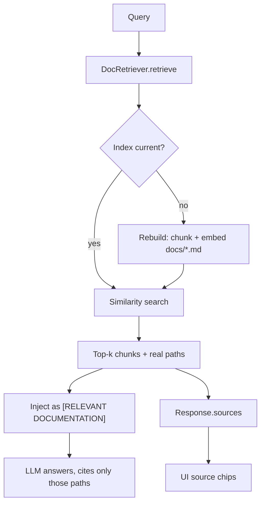

# AI Documentation Retrieval (Knowledge Grounding)

The AI **knowledge path** — how-to, definition, and product questions routed to
`knowledge` mode (see [Query Intent Routing](ai-query-routing.md)) — answers from
documentation, not live device data. This page describes how those answers are
**grounded in the real `docs/*.md` corpus** so the model cites files that exist.

This is the "Tier C" grounding layer from
[§8.1 of the routing design](ai-query-routing.md#81-grounding-sources-of-truth-code-vs-docs),
implemented in `ai/doc_retriever.py`.

| | Documentation retrieval |
|---|---|
| **What** | Vector index over the whole `docs/*.md` corpus |
| **Where** | ChromaDB store on disk (`ai/data/docs_chroma`) |
| **Recall** | Top-k chunks by cosine similarity to the query |
| **Injected as** | `[RELEVANT DOCUMENTATION]` block (real `docs/…` paths) |
| **Returned as** | `sources: [docs/…]` in the `/ai/query` response |
| **Code** | `ai/doc_retriever.py`, `AIEndpoint._answer_knowledge` |

---

## Why

The knowledge path used to answer from a **fixed list of five docs truncated to
500 characters each** (`SystemKnowledge.get_documentation_context`). Topics
outside that list — most notably *"How do I enrol a device?"* — had no real
source, so the model **invented citations** (e.g. `[DOC SOURCE]
docs/device-enrolment.md`, a file that does not exist).

Retrieval replaces "first 500 chars of 5 files" with query-relevant context drawn
from the **entire corpus**, labelled with the true repo path. The model is told to
cite only those paths, and the backend returns the same paths as structured data
so the UI never has to trust model-written citations.

---

## How it works



### Chunking

Documents are split **by markdown heading**: each section becomes a chunk whose
content is prefixed with its heading (so the embedder sees the section title).
Sections longer than `chunk_size` are split into overlapping windows
(`chunk_overlap`). Each chunk keeps:

- `source` — the repo-relative path, e.g. `docs/device-registration.md`;
- `title` — the document's first `#` heading;
- `heading` — the section heading the chunk came from.

### Indexing & versioning

The index is a ChromaDB collection (`project_docs`) built lazily on the first
retrieval. A **version hash** over the corpus `(path, size, mtime)` *and* the
indexing settings (`chunk_size`, `chunk_overlap`, `max_chunks_per_doc`,
`max_file_bytes`) decides whether the index is stale, so a stable corpus is a
**no-op** on every later query; editing a doc — or changing how the corpus is
chunked — rebuilds the index once. A sentinel document (`__index_version__`)
records the current version.

The indexing settings are part of the hash on purpose: each one changes what
gets stored, so without them a config edit would silently keep serving chunks
built with the old values (e.g. lowering `chunk_size` would have no effect).

### Retrieval

`retrieve(query)` returns chunks ranked by cosine similarity, capped at
`n_results` and filtered by `max_distance` (lower distance = closer). Production
uses ChromaDB's default embedder — the same model long-term memory already
downloads; tests inject a deterministic embedder so they never need it.

### Prompt injection & citation rule

Retrieved chunks are rendered as a `[RELEVANT DOCUMENTATION]` block and added to
the conversation context (`AIEndpoint._format_retrieved_docs`):

```
[RELEVANT DOCUMENTATION]
--- docs/device-registration.md — Enrolment workflow ---
# Enrolment workflow
Create a site, generate a bootstrap key, …
```

The knowledge system prompt (`SystemKnowledge.get_knowledge_prompt`) instructs
the model to **cite only** paths present in that block and to say so when nothing
relevant was retrieved. The fixed five-doc excerpt list is no longer embedded in
the prompt; it is kept **only as a fallback** when retrieval returns nothing.

!!! note "Diagnostic path is unchanged"
    `get_system_prompt()` (the diagnostic/operational prompt) is untouched and
    byte-identical, so the startup warm-up prefix and its Ollama KV-cache hit are
    preserved.

### Response & UI

The knowledge response adds a machine-readable `sources` list:

```json
{
  "response": "…",
  "trust": { "trust_mode": "informational", "actionable": false, … },
  "routing": { "resolved": "knowledge", … },
  "sources": ["docs/device-registration.md"]
}
```

`AskAIWidget` stores these as `homepot_ai_sources` and renders them as file chips
under the "Knowledge — answered from documentation" badge. Diagnostic answers
have no `sources` and show the normal gate trust banner.

---

## Configuration

The `docs:` section of `ai/config.yaml` (`ai/doc_retriever.py`):

| Key | Default | Meaning |
|---|---|---|
| `chroma_path` | `data/docs_chroma` | ChromaDB path (relative to `ai/`) |
| `collection_name` | `project_docs` | ChromaDB collection name |
| `distance_metric` | `cosine` | `cosine` (0..2) or `l2` |
| `n_results` | `4` | Max chunks injected per query |
| `max_distance` | `0.9` | Relevance cutoff; `null` disables it |
| `chunk_size` | `800` | Characters per chunk (~200 tokens) |
| `chunk_overlap` | `150` | Overlap between split windows |
| `max_chunks_per_doc` | `60` | Bound one document's contribution |
| `max_file_bytes` | `2000000` | Skip unreasonably large files |

### Cost

The retrieved block sits in the **user turn**, not the system prompt, so Ollama
re-evaluates it on every request (the system prompt is the part the startup
warm-up primes). On the CPU demo host prompt eval runs at ~25–35 tok/s, so the
injected characters map directly onto seconds of wait. Measured on the live host
with an identical system prompt, changing only the retrieved block:

| Question | `6` × `1200` | `4` × `800` | Saved |
|---|---|---|---|
| Explain device credentials and tokens | 36.4 s | 14.9 s | 21.5 s |
| What does `root_access` allow? | 36.2 s | 19.9 s | 16.3 s |

Averaged over 8 representative questions, `6` × `1200` injects ~2,950 chars
(~740 prompt tokens) per query and `4` × `800` injects ~1,730 (~430 tokens) — a
41% cut — with the block bounded at ~3.4k chars worst case (4 × `chunk_size`
plus labels). Prompt-eval time for a repeated question is near zero: Ollama
keeps the evaluated prefix cached while the model stays resident.

!!! note "Trade-off"

    Fewer chunks means less context for "list everything" questions: on
    *"What does `root_access` allow?"* the `4` × `800` answer is correct but less
    exhaustive than the `6` × `1200` one (it gives the reboot/shutdown
    capability without also listing sudo, filesystem scan, and config/firmware
    updates). `5` × `800` behaved the same way, so dropping one chunk is not
    what recovers it. How-to questions ("enrol a device", "push notifications",
    "device credentials") were unaffected in the same test. If completeness
    outweighs the ~17–22 s, restore `n_results: 6` and `chunk_size: 1200`.

!!! warning "First query pays the indexing cost"
    The index is built lazily on the first knowledge query: the whole corpus is
    chunked and embedded once (it reuses the embedder long-term memory already
    uses). This happens **outside** the AI concurrency gate, so it never holds a
    generation slot. Later queries are a no-op unless a document changes.

---

## Operations

- **Location:** `ai/data/docs_chroma` (git-ignored via `ai/data/`).
- **Rebuild:** edit/delete the directory, or call `DocRetriever.ensure_indexed(force=True)`.
  Normal invalidation is automatic (a doc's `path/size/mtime`, or any indexing
  setting such as `chunk_size`, changing).
- **Stats:** `DocRetriever.get_stats()` returns the chunk count and paths.
- **Failure is non-fatal:** retrieval errors are caught in `_answer_knowledge`
  and fall back to the fixed doc excerpts; a knowledge answer is always produced.

---

## Testing

- `backend/tests/test_ai_doc_retrieval.py` (10 tests) exercises the real ChromaDB
  index with a deterministic embedder: retrieval relevance + real source,
  heading metadata, re-index on corpus change, re-index on an indexing-config
  change, stable-corpus no-op, empty query, distance cutoff, long-section
  windowing, and a missing docs directory.
- `backend/tests/test_ai_query_routing.py` knowledge tests assert the
  `[RELEVANT DOCUMENTATION]` block, the `sources` response field, and that the
  fixed-doc fallback is **not** used when retrieval hits.
- `frontend/src/components/Dashboard/AskAIWidget.test.jsx` covers source-chip
  rendering/persistence and their absence on diagnostic answers.

---

## Relationship to query routing

`knowledge` mode uses this retrieval layer; `diagnostic`/`action` modes are
unaffected and stay anchored to live data through the validation gates. The model
must still never present live operational state in `knowledge` mode, even if a
retrieved snippet mentions a device (see
[Query Intent Routing §8](ai-query-routing.md#8-knowledge-path-details)).

This layer covers **prose docs only**. On-demand, exact access to code is a
separate, design-only capability — [AI Code Access (Tier B)](ai-code-access.md) —
which reads live files instead of a pre-built index, and is meant to compose with
this one (retrieve docs first; read code when precision is needed).

---

## References

- `ai/doc_retriever.py` — `DocRetriever` (chunking, indexing, retrieval).
- `ai/config.yaml` — the `docs:` configuration section.
- `backend/src/homepot/app/api/API_v1/Endpoints/AIEndpoint.py` — `get_doc_retriever`,
  `_format_retrieved_docs`, and the `_answer_knowledge` wiring.
- `ai/system_knowledge.py` — `get_knowledge_prompt` (citation rule) and the
  `get_documentation_context` fallback.
- `frontend/src/components/Dashboard/AskAIWidget.jsx` — source chips.
- [AI Memory](ai-memory.md) — the same ChromaDB stack for long-term recall.
- [Query Intent Routing](ai-query-routing.md) — modes and the grounding tiers.
- [AI Code Access (Tier B)](ai-code-access.md) — live read-only code tools
  (design-only).
