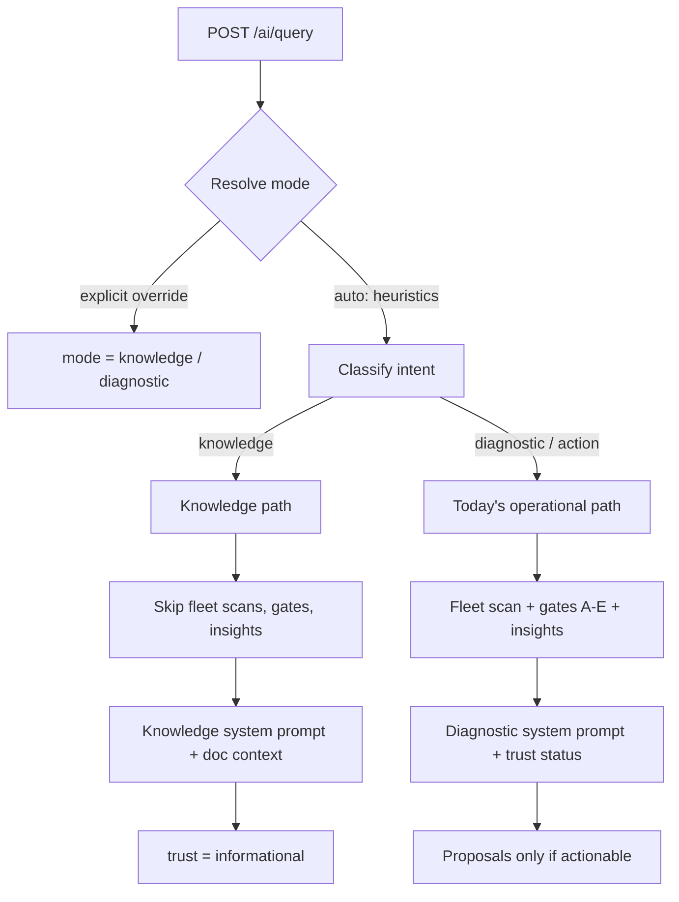

# AI Query Intent Routing (Design)

> **Status:** Proposed / design-only — no code changes in this document yet.
> **Goal:** let the assistant answer **informational / how-to** questions (e.g.
> "how do I enroll a device?", "what does `root_access` mean?") **without**
> running the device-data validation pipeline, while the **diagnostic** and
> **action** paths behave exactly as they do today.
> **Related:** [Agentic AI](ai-agentic.md) | [Trust & Validation Gates](ai-validation-gates.md) | [Task Delegation](ai-delegation-plan.md) | [Concurrency & Load](ai-concurrency.md) | [AI Memory](ai-memory.md)

---

## 1. Problem

Every `POST /ai/query` currently runs the **same** pipeline regardless of what
is being asked (`backend/src/homepot/app/api/API_v1/Endpoints/AIEndpoint.py`):

1. Memory recall + **fleet-wide DB scans** (sites, active devices, alerts),
   push/job context, and enriched per-device context (`AIEndpoint.py:574-766`).
2. **Gates A–E** always run — `envelope.run(gate_context)` — except the
   zero-fleet short-circuit (`AIEndpoint.py:809-810`, `800-807`).
3. **AI insights** (system anomaly scan + failure prediction) run whenever Gate
   B passes (`AIEndpoint.py:826-878`).
4. The prompt always receives a `[VALIDATION TRUST STATUS]` block, and for
   non-actionable answers a `Failed gate: …` line; zero-fleet adds a
   `[REFUSAL MANDATE]` (`AIEndpoint.py:921-956`).
5. The system prompt then hard-instructs the model: *"If 'Actionable' is 'no',
   you MUST explicitly tell the user their data could not be fully validated …
   limit your answer to cautionary, non-actionable observations"*
   (`ai/system_knowledge.py:197-204`).

The result for a pure knowledge question ("how do I enroll a device?"):

- **Cost:** it pays the full operational-data + gate latency, which is
  significant on a CPU-only inference host.
- **Answer quality:** the model is pushed toward device-diagnostic, cautionary
  framing that has nothing to do with the question, so it can hedge or refuse
  even though the answer is documentation knowledge.
- **Misleading signal:** the response carries a `trust` envelope with a
  `failed_gate`, implying the *answer* was unvalidated when the gate concerns
  device telemetry the question never needed.
- **Thin knowledge base:** the docs handed to the model are a fixed set of five
  (`ai/system_knowledge.py:221-227`) with no enrollment/how-to content.

## 2. Goal and non-goals

**Goal**

- Route each query by **intent** and give the assistant a first-class
  **knowledge path** that answers how-to/definition/product questions from
  documentation, quickly and without the device gates.
- Leave the **diagnostic** and **action** paths — gates, insights, proposals,
  approval, execution — **unchanged**.

**Non-goals**

- Removing or weakening the validation gates for diagnostic/action queries.
- Changing proposal/approval/execution semantics (Level 2 delegation).
- Any change to what the AI may *do* — the AI still cannot execute anything.

## 3. Intent classes

| Class | Meaning | Examples |
|---|---|---|
| `knowledge` | Question answerable from product documentation / definitions; no live device state needed | "How do I enroll a device?", "What does `root_access` allow?", "Which command restarts an agent?" |
| `diagnostic` | Question about the **current or historical state** of the fleet | "Why is device X offline?", "Any anomalies at Site B today?", "Show stale devices." |
| `action` | A request that should produce a **proposed action plan** | "Restart device X.", "Raise brightness on the lobby display." |

`action` is a subset of the operational path; it is separated only so the
router can bias toward the agentic proposal flow and so the UI/labels can differ.

## 4. Design overview



Nothing between the router and the executor is LLM-generated, and the knowledge
path can never create a plan.

## 5. Classification: heuristics + explicit override

Per the chosen approach, the default is **deterministic heuristics with no extra
LLM call** (keeps the CPU host fast), plus an **explicit override** the user can
set. The router is intentionally conservative: **when in doubt, fall back to
`diagnostic`** so today's (safe) behaviour is the default.

Resolution order (first match wins):

1. **Explicit override.** `request.mode` (`knowledge` | `diagnostic` | `auto`).
   `auto` (default) proceeds to heuristics.
2. **`action` intent.** If the query contains an imperative action signal for a
   declared capability (e.g. "restart", "reboot", "apply config", "set … to
   …", "change settings") → `diagnostic`/`action` path (agentic + proposals).
3. **`device_id` present.** A query scoped to a concrete device is treated as
   `diagnostic` (the user is asking about that device), unless the override says
   otherwise.
4. **`knowledge` intent.** If the query matches how-to/definition signals
   (interrogatives such as *how do I / how to / what is / what does / explain /
   where can I find / which command / meaning of*, plus a small allowlist of
   product terms) → `knowledge`.
5. **Default.** `diagnostic`.

Illustrative signals (tunable, single source of truth in config):

```text
KNOWLEDGE_PATTERNS = [
  r"\bhow (do|can|to|does)\b", r"\bwhat (is|are|does|do)\b",
  r"\bexplain\b", r"\bmeaning of\b", r"\bwhere (can|do) i\b",
  r"\bwhich command\b", r"\benroll(ment)?\b", r"\bpermission\b",
  r"\bdocumentation\b", r"\bhow it works\b",
]
ACTION_PATTERNS = [
  r"\brestart\b", r"\breboot\b", r"\bapply\b", r"\bset .* to\b",
  r"\bchange .* config", r"\bpush .* config", r"\bshut ?down\b",
]
```

Notes:

- **Conversation continuity:** a follow-up in an existing conversation
  ("and what about 24-bit?" after a knowledge answer) should inherit the prior
  turn's mode from `history` when the new text alone is ambiguous. If that is
  too much for v1, ambiguous follow-ups fall back to `diagnostic`.
- **Specific how-to about "my device X"** is a genuine ambiguity (device_id
  present ⇒ step 3 ⇒ diagnostic). The override lets a user pin `knowledge`; a
  later refinement can use embeddings-based routing.

## 6. Request and response contract

`AIQueryRequest` (`AIEndpoint.py:179`) gains one field:

```python
mode: Literal["auto", "knowledge", "diagnostic"] = Field(
    default="auto",
    description="Force a query path; 'auto' classifies by intent (default).",
)
```

The response echoes the **resolved** routing so callers can log/debug it:

```json
{
  "response": "...",
  "trust": { "mode": "informational", "score": null, "actionable": false },
  "routing": { "requested": "auto", "resolved": "knowledge", "reason": "how-to signal: 'how do i enroll'" }
}
```

Backwards compatible: existing callers omit `mode` and (for genuine diagnostic
questions) behave exactly as before.

## 6.1 UI — how a technician chooses

Today's Dashboard chat is `AskAIWidget.jsx` (rendered at `Dashboard.jsx:520`,
titled "System Diagnostics AI"). It has one input + send and calls
`api.ai.query(query, null, userRole)` (`AskAIWidget.jsx:340`), which posts
`{ query, role }` (`api.js:788`) — no `agentic`, no `mode` — so every question
takes the same gate-heavy path and always renders the `TrustBanner` +
`GateReplay`. There is **no selector today**; the mode is neither user-chosen nor
LLM-chosen because the field does not exist yet.

The design adds one control, with `Auto` as the default:

```
┌ System Diagnostics AI ───────────────────────────┐
│  [ response area ]                               │
│  ┌────────────────────────────────┐  ┌────────┐  │
│  │ Ask about status or how-to…    │  │  Send  │  │
│  └────────────────────────────────┘  └────────┘  │
│  Mode:  ( Auto )  Knowledge   Diagnostic         │
└──────────────────────────────────────────────────┘
```

- **Control:** a compact segmented control (`Auto` / `Knowledge` / `Diagnostic`)
  next to the input, defaulting to `Auto` — this is the override from §5.
- **Plumbing:** `api.ai.query` gains a `mode` argument and includes it in the
  payload; `AskAIWidget` passes the selected value. `Auto` sends `mode: "auto"`
  (or omits it — the backend default).
- **Only the technician selects `Knowledge`/`Diagnostic`; the LLM never picks the
  mode.** Under `Auto`, the backend heuristics resolve it (§5).
- **The UI reflects the resolved mode** (`routing.resolved` in the response):
  - `diagnostic` / `action` → today's `TrustBanner` + `GateReplay`, unchanged.
  - `knowledge` → hide the trust UI (no gates ran); show a small "Knowledge"
    chip and, optionally, the cited sources.
- **Optional:** remember the last choice per session — localStorage already holds
  `homepot_ai_query`/`_response`/`_trust`, so add a `homepot_ai_mode` key.

## 7. Per-mode pipeline

| Step | `knowledge` | `diagnostic` / `action` |
|---|---|---|
| Auth (`require_user`) | yes | yes |
| Memory-scope resolution + scoped recall | yes (RBAC unchanged) | yes |
| Fleet/sites/devices/alerts DB scans | **skip** | yes |
| Enriched per-device context | skip | yes |
| Gates A–E | **skip** | run |
| AI insights (anomaly + failure prediction) | skip | run when Gate B passes |
| System prompt | **knowledge prompt** (§8) | diagnostics prompt (current) |
| `[VALIDATION TRUST STATUS]` / refusal mandate | **not injected** | injected |
| Proposals | **never** | only if trust actionable and run healthy |
| Response `trust` | informational (§9) | envelope (current) |

Skipping gates/insights for `knowledge` removes the DB work and the
cautionary instructions in one move.

## 7.1 Knowledge mode and the analysis-mode guard

None of the diagnostic/cautionary behaviour should leak into `knowledge`. The
knowledge prompt does **not** contain the "if Actionable is no, you MUST warn…"
instruction, and the `[VALIDATION TRUST STATUS]` / `[REFUSAL MANDATE]` blocks are
not assembled at all.

## 8. Knowledge path details

**Prompt.** A separate knowledge-oriented system prompt (identity: product /
SOP assistant for HOMEPOT). It keeps the command-payload reference
(`ai/system_knowledge.py:248-342`) and the role definitions, but drops the
operational "diagnose the fleet" framing and the trust instruction.

**Documentation context — implemented (v1).** The path retrieves the most
relevant chunks from the **whole `docs/*.md` corpus** and injects them as a
`[RELEVANT DOCUMENTATION]` block with real file paths (see
[§8.1](#81-grounding-sources-of-truth-code-vs-docs) and
[AI Documentation Retrieval](ai-doc-retrieval.md)). The old fixed five-doc
excerpt list (`ai/system_knowledge.py:279-314`) is kept only as a fallback when
retrieval returns nothing. The knowledge path must never present operational
data as if it were live.

**No proposals.** The `propose_device_action` tool is not offered to the model
on this path, so a knowledge run cannot emit a plan even if the model tries.

## 8.1 Grounding & sources of truth (code vs docs)

The knowledge path is only as good as what the model is given, and today that is
**metadata and a fixed set of doc excerpts — never the code**. This subsection
defines how the assistant should stay anchored to the code, since the code — not
the prose — is the point of reference when they diverge.

### What the assistant sees today

| Source | What is exposed | Limits | Ref |
|---|---|---|---|
| README | intro prose | ~1800 chars, to first section | `ai/system_knowledge.py:36-61` |
| Project structure | **file names only** (4 dirs) | top 15 files each | `ai/system_knowledge.py:64-97` |
| DB schema | tables + first columns, **parsed from models** | 15 cols/table, ≤4500 chars | `ai/system_knowledge.py:99-148` |
| Documentation (knowledge path) | **whole `docs/*.md` corpus, retrieved per query** | top-k chunks + `max_distance` cutoff | `ai/doc_retriever.py` |
| Documentation (fallback) | **first 500 chars** of 5 docs | fixed list; used only when retrieval misses | `ai/system_knowledge.py:279-314` |
| Command reference | **hand-written literal** | static string | `ai/system_knowledge.py:316-410` |
| Agent tools | live device/fleet/memory reads + proposal capture | no code/doc access | `ai/tools.py:468-478` |

So the model can list files and see a slice of the schema, but **cannot open,
read, or search a source file on demand**. When docs drift from code it has no
route to the truth — and while the DB schema is *derived* from code, the command
reference is manual and can silently fall out of sync.

The knowledge path's *documentation* grounding now retrieves from the whole
corpus (Tier C, below); everything else in this table is unchanged, and there is
still **no on-demand code/source access** (that is Tier B).

### Grounding tiers (cheapest → richest)

**Status:** Tier C is **implemented** (v1) — see
[AI Documentation Retrieval](ai-doc-retrieval.md). Tier A and Tier B remain
proposals.

**Tier A — generate structured references from code (recommended first).**
Replace hand-maintained literals with values derived from their real source at
build/startup, so structured facts cannot drift:

- command payloads ← `homepot.agent.utils.command_poller.COMMAND_TYPES` and the
  `REQUIRED_PERMISSION` map;
- proposable actions ← `ai/actions.py` (`ACTION_REGISTRY`);
- API surface ← the FastAPI app's routes;
- DB schema ← the SQLAlchemy models (already done at
  `ai/system_knowledge.py:83-133`).

Generate at process start, and/or via a build step whose output is committed and
diffable. Deterministic, no LLM, no per-query cost.

**Tier C — retrieve docs (+ selected generated references) instead of fixed
excerpts. — ✓ implemented (v1)**
A ChromaDB index over the docs (`ai/doc_retriever.py`) chunks the corpus and
retrieves the top-k relevant chunks for the query, attaching **citations** (real
`docs/…` paths). This replaces "first 500 chars of 5 files" with query-relevant
context inside a bounded budget, and lets the corpus grow without bloating every
prompt.

As built: heading-aware chunking, a ChromaDB collection under `ai/data/docs_chroma`
with version-gated rebuilds (`path/size/mtime` plus the indexing settings), the
chunks injected as a `[RELEVANT DOCUMENTATION]` block, and the retrieved paths
returned as a machine-readable `sources` list (rendered as chips in the UI). It
reuses the existing ChromaDB/embedder stack rather than `DeviceMemory` directly,
so the two stores stay separate. Generated Tier-A references are **not** indexed
yet. Full details: [AI Documentation Retrieval](ai-doc-retrieval.md).

**Tier B — read-only code tools (design-only; see
[AI Code Access (Tier B)](ai-code-access.md)).**
Add allowlisted, sandboxed tools to the knowledge and agentic paths:

```
read_file(path)       # numbered lines, capped
search_code(pattern)  # ripgrep-style, capped result count
list_dir(path)
```

Hard constraints:

- **Allowlist** roots only (`docs/`, `backend/src/`, `ai/`, `frontend/src/`),
  with path normalization to block traversal/symlinks.
- **Size/line caps** (e.g. ≤400 lines, ≤20 hits) and explicit truncation markers.
- **Secret exclusion** — refuse `.env` and credential/key files via a denylist;
  never echo environment variables.
- **Read-only** and **audited** (via the existing audit logger); available on
  `knowledge`/agentic runs only — never a new mutate path.
- Answers that use code must **cite** `path:line`.

B is more powerful but costs model iterations on the CPU host, so it must be
bounded and enabled deliberately. Full contracts, safety envelope, and rollout:
[AI Code Access (Tier B)](ai-code-access.md).

### Freshness & invalidation

- Tier A references are regenerated at process start (and can be committed);
  they are the anti-drift guarantee for structured facts.
- The system prompt is rebuilt per request today (`AIEndpoint.py:1014`), so doc
  edits are already picked up without a restart. Keep that for docs, but keep
  the generated references deterministic so the startup warm-up prefix
  (`homepot/app/main.py:204`) stays identical and the KV cache still hits —
  see *Prompt-prefix caching* below for what it costs when that breaks.
- Retrieval-index rebuilds stay out of the request path (startup or an explicit
  reindex) to avoid per-query cost.

### Prompt-prefix caching (path-switch latency)

Ollama reuses its KV cache for the **common prefix** of two prompts: when the
leading bytes of a request match the previous one, only the new tail is
evaluated; when they diverge early, the whole prompt is re-evaluated.
Prompt-eval on the demo host (`llama3.2` on 4 CPU cores) runs at ~30 tok/s and
is the dominant cost of a query that is not cache-warm:

| case | tokens evaluated | prompt-eval time |
| --- | --- | --- |
| prefix matches the previous request | ~450 (the tail) | ~17 s |
| prefix is cold (never seen / model reloaded) | ~3,500 (whole prompt) | 111-132 s |
| exact same prompt repeats | ~0 | 0.2-0.9 s |

`main.py` warms the model at startup by sending the **diagnostic** prompt, so
for that warm-up to be worth anything, every other path must *start with those
same bytes*. Both paths therefore begin with `SystemKnowledge._shared_prefix()`
— the static system context, the command-payload reference and the role
definitions — and only then add their mode-specific identity, capability list
and instructions. The diagnostic-only `[DOCUMENTATION]` block sits after that
fork on purpose: including it earlier would break the prefix for `knowledge`,
which deliberately omits it.

This is enforced, not just intended: `backend/tests/test_ai_system_prompt_cache.py`
asserts that the shared block leads all three prompts (diagnostic, knowledge,
knowledge + repo tools) and stays byte-identical between calls.

Before the paths were aligned, they forked at character 30 — the first sentence
of the identity line ("...System Diagnostics AI" vs "...Knowledge Assistant") —
so switching from a diagnostic to a knowledge question re-evaluated the entire
~3.2k-token system prompt. Measured with the model unloaded between runs, so
both prefixes started genuinely cold:

```
switch diagnostic -> knowledge, prompt evaluation
  before: 111,887 ms
  after :  17,020 ms      (6.6x faster, ~95 s saved per switch)
```

Rotating a conversation between the two paths is the normal demo case, so this
is the difference between a ~2-3 minute answer and a ~1 minute one. Note what
the fix does *not* do: everything after the fork — the mode-specific
instructions plus the per-query user turn (retrieved docs, live status) — is
still evaluated on every request at ~30 tok/s. Shrinking the prompt or the
retrieved context is the lever for that.

Consequences for future edits:

- Keep the shared block first and deterministic. A per-request value inside it
  (timestamp, request counter, unsorted directory walk) would silently disable
  prefix reuse for *every* query on every path.
- Mode-specific text belongs in the tail: `[RELEVANT DOCUMENTATION]`, the
  `[VALIDATION TRUST STATUS]` protocol and the repo-tool guidance are all
  tail-only today.
- When adding a new path, start its system prompt with `_shared_prefix()`.


### Relationship to the routing design

`knowledge` uses Tier A + Tier C (and optionally B); the `diagnostic`/`action`
paths are unaffected — they stay anchored to live data through the gates. The
model must still never present live operational state in `knowledge` mode, even
if a retrieved snippet mentions a device.

## 9. Trust reporting

For `knowledge` queries the response `trust` is **informational**, not a gate
result:

- `trust_mode`: a new non-gate mode (e.g. `informational` / `none`),
- `trust_score`: `null` (or omitted),
- `actionable`: `false`, `failed_gate`: `null`.

This is accurate (no device data was validated because none was needed) and
prevents the UI from rendering a "failed gate" banner for a how-to answer. The
delegation UI is unaffected: it only acts on plans, which only exist on the
operational path.

## 10. Safety & RBAC

- `require_user` auth, memory scoping, and site/device access rules are
  unchanged and apply to all modes.
- The knowledge path is **read-only by construction**: no fleet scan, no gates,
  no proposal tool, no execution.
- **Bias to safety:** any ambiguity resolves to `diagnostic`. A query that hints
  at action ("just restart it for me") matches the action signals and follows the
  operational path, where the full gate + approval + execution controls apply.

## 11. Configuration & rollout

- **Flag:** `AI_QUERY_ROUTING` (`heuristics` default, `off` to disable) so the
  behaviour can be rolled back without a code change.
- **Config:** the pattern lists and mode defaults live in one tunable module.
- **Phases:**
  1. Add the `mode` field + resolver + knowledge path behind the flag, with
     tests; log the resolved mode. Default remains effectively current
     behaviour for diagnostic queries.
  2. Add the chat UI mode selector (Auto / Knowledge / Diagnostic) and surface
     the resolved mode in the response.
  3. Expand the knowledge corpus + relevance selection; review misroutes.

## 12. Observability

- Log the resolved mode and the deciding signal at INFO.
- Add a `routing_mode` field to the `ai_query` audit event metadata.
- Metrics: request latency by mode, share of `knowledge` queries, override rate,
  and any user-reported misroutes (to tune the patterns).

## 13. Testing

- **Router unit tests:** table-driven matrix — knowledge/diagnostic/action
  phrasings; override beats heuristics; `device_id` ⇒ diagnostic; ambiguous ⇒
  diagnostic; continuation inherits mode (if implemented).
- **API tests:** a `knowledge` query performs **no** gate/insight DB access
  (assert the gate/envelope path is not invoked) and returns informational
  `trust`; a `diagnostic` query is byte-for-byte the current behaviour; proposals
  are only ever produced on the operational path.
- **Grounding tests (Tier C) — implemented:** `backend/tests/test_ai_doc_retrieval.py`
  exercises the real ChromaDB index with a deterministic embedder (retrieval
  relevance + real source, heading metadata, reindex on corpus change,
  stable-corpus no-op, empty query, distance cutoff, long-section windowing,
  missing docs dir); the knowledge-path tests assert the `[RELEVANT DOCUMENTATION]`
  block, the `sources` response field, and that the fixed-doc fallback is not used
  on a retrieval hit; the frontend tests cover the UI source chips. See
  [AI Documentation Retrieval § Testing](ai-doc-retrieval.md#testing).
5. **Naming:** `knowledge` vs `informational` vs `general`; and the new
   `trust_mode` label.
6. **Grounding scope:** do we ship Tier A alone in v1, or A + C? (Proposed: A
   first — it removes the real drift — then C.)
5. **Tier-B code tools:** enable read-only `read_file`/`search_code` in v1, or
   defer until Tier A/C are in place? (Proposed: defer.)
7. **Retrieval details:** chunk size, embedding model, and index refresh cadence
   (startup vs explicit reindex).
8. **Citations in the UI:** render `path:line` / `doc#anchor` as links, or plain
   text?
- **Grounding tests (Tier A / Tier B — not yet implemented):** a drift test
  asserting generated Tier-A references match `COMMAND_TYPES`/`ACTION_REGISTRY`;
  Tier-B tools reject paths outside the allowlist, `.env`, and oversized reads.
  (Tier C retrieval is covered by the grounding tests above.)

## 14. Open questions

1. **Follow-up continuity:** inherit mode from `history`, or rely on the
   override for v1? (Proposed: override only in v1.)
2. **"How do I enroll *my* device X"** (device_id present but a how-to):
   accept that this routes to `diagnostic`, or add a "device-scoped knowledge"
   sub-case? (Proposed: route to `diagnostic`, override available.)
3. **Doc selection:** static expanded list vs keyword-scored relevance in v1?
   (Proposed: keyword-scored within a bounded budget.)
4. **Should `knowledge` recall long-term memory?** (Proposed: yes, same scoped
   recall — it can carry useful prior answers — but never invent live state.)
5. **Naming:** `knowledge` vs `informational` vs `general`; and the new
   `trust_mode` label.

## 15. References

- `backend/src/homepot/app/api/API_v1/Endpoints/AIEndpoint.py` — `/ai/query`
  handler (context assembly, gates, insights, trust injection, proposals).
- `ai/system_knowledge.py` — system prompt, documentation context (fallback),
  command reference.
- `ai/doc_retriever.py` — the Tier C documentation index/retrieval
  (`DocRetriever`); configured by the `docs:` section of `ai/config.yaml`.
- `ai/tools.py` — the agent's tool set (live-data reads + proposal capture; no
  code access today).
- `ai/gates/` — the validation envelope (A–E) and `EnvelopeResult`.
- `frontend/src/components/Dashboard/AskAIWidget.jsx` and
  `frontend/src/services/api.js` (`api.ai.query`) — the chat surface and the
  mode plumbing described in § 6.1.
- [AI Documentation Retrieval](ai-doc-retrieval.md) — the implemented Tier C
  grounding layer.
- [AI Memory](ai-memory.md) — the shared ChromaDB stack.
- [Agentic AI](ai-agentic.md), [Trust & Validation Gates](ai-validation-gates.md),
  [Task Delegation](ai-delegation-plan.md), [Concurrency & Load](ai-concurrency.md).
