# Collect Support Bundle

The `collect_support_bundle` device command gathers a point-in-time snapshot of
the device's hardware, OS, processes, metrics, logs, and configuration into a
single zip file, uploads it to the backend, and makes it downloadable from the
Dashboard for debugging.

## Overview

A technician or admin composes the **Collect Support Bundle** command from the
Dashboard push-review page (group: **Diagnostics**, permission: `command_execution`).
The device agent executes it locally, creates a zip, persists it, uploads it to
the backend, and posts the result (including a download URL) back. The
technician can then download the bundle from the device's push history.

## What's in the bundle

| File | Source | Description |
|------|--------|-------------|
| `system_info.json` | `_run_get_system_info` | Hardware/OS inventory (CPU, RAM, OS build, serial, GPU) |
| `drives.json` | `_run_list_drives` | Mounted drives and free space |
| `processes.json` | `_run_list_processes` | Running processes (top 50 by CPU) |
| `metrics.json` | `_metrics_snapshot` | CPU, memory, disk utilization |
| `homepot_data/logs/agent.log` | `C:\ProgramData\Homepot\logs\` | Agent structured log (rotating, 10 MB max) |
| `homepot_data/logs/agent-*.log` | `C:\ProgramData\Homepot\logs\` | Electron supervisor stdout/stderr capture |
| `homepot_data/app-events.json` | `C:\ProgramData\Homepot\` | User App application events (Electron) |
| `homepot_data/submissions.jsonl` | `C:\ProgramData\Homepot\` | Submission log |
| `homepot_data/identity/*` | `C:\ProgramData\Homepot\identity\` | Device identity files |
| Other config files | `C:\ProgramData\Homepot\` | Any other non-credential files |

### Excluded from the bundle
- `credentials/` directory and `credentials.json`
- `.env` files
- Files named `secret` or `secrets`
- Files larger than 5 MiB (per-file cap)

## Flow

```mermaid
graph LR
    T[Technician] -->|Compose command| D[Dashboard PushReview]
    D -->|Queue command| B[Backend]
    B -->|Poll| A[Device Agent]
    A -->|Execute locally| Z[Create zip]
    Z --> P[Persist to ProgramData/Homepot/support-bundles/]
    P --> U[Upload to backend]
    U --> R[Post result with download_url]
    R --> DB[(device_commands.result)]
    DB --> H[Push History]
    H -->|Download button| DL[Download zip]
```



## Agent side

### Handler: `_run_collect_support_bundle`

Located in `backend/src/homepot/agent/utils/command_poller.py`. The function:

1. Gathers snapshots (system info, drives, processes, metrics) as JSON files.
2. Copies the contents of the Homepot data directory (`C:\ProgramData\Homepot\` on
   Windows, `~/AppData/Local/Homepot/` as dev fallback) into a `homepot_data/`
   subdirectory of the temp bundle, skipping credentials/secrets and capping
   per-file size at 5 MiB.
3. Creates a zip archive in the system temp directory.
4. Saves a copy to the persistent directory `C:\ProgramData\Homepot\support-bundles\`.
5. Uploads the zip to `POST /api/v1/devices/{device_id}/support-bundle`.
6. Returns `status`, `path`, `size_bytes`, `file_count`, `created_at`, and
   `download_url` (if upload succeeded) in the result.

### Command type registration

- `COMMAND_TYPES`: includes `"collect_support_bundle"`
- `REQUIRED_PERMISSION`: gated on `command_execution`
- Permission: `command_execution` (Monitor tier)

### restart_agent note

The `restart_agent` command is processed **locally** by the agent (not routed
through IPC) so the Electron supervisor can respawn the process with the
reserved exit code 42. This ensures the supervisor does not count it as a crash.

## Backend endpoints

### Upload (device-authenticated)

```
POST /api/v1/devices/{device_id}/support-bundle
```

- Auth: `X-Device-ID` / `X-API-Key` headers
- Body: multipart form with `file` (zip) and optional `command_id`
- Response: `{status, bundle_id, filename, download_url, size_bytes}`
- Stores file in `backend/src/homepot/data/support-bundles/{bundle_id}.zip`

### Download (user-authenticated)

```
GET /api/v1/support-bundles/{bundle_id}
```

- Auth: standard user session (Manage permission)
- Returns: the zip file as `application/zip`
- `bundle_id` must be a valid UUID

## Dashboard (web UI)

The device **Push History** page (`/device/:id/history`) shows a
**"Download Support Bundle"** button in the command detail panel when a
`collect_support_bundle` result contains a `download_url`. The `bundle_id` is
also displayed for reference.

## User App (Electron)

The User App records application events in `app-events.json`. On Windows, this
file is stored in `C:\ProgramData\Homepot\app-events.json` (moved from the
Electron `userData` directory) so the agent and support bundle can access it.

## Security

- `device_id` is validated (no path separators or traversal sequences).
- `bundle_id` is validated as a UUID before use.
- File paths are constructed from server-generated UUIDs only (no user-provided
  data in path expressions).
- File content is read into memory before returning (avoids CodeQL
  path-injection alerts).
- Credential/secret files are excluded from the bundle.
- Per-file size capped at 5 MiB.

## Files

| File | Role |
|------|------|
| `backend/src/homepot/agent/utils/command_poller.py` | `_run_collect_support_bundle` handler |
| `backend/src/homepot/agent/real_device_agent.py` | Command routing (restart_agent exclusion, upload logic) |
| `backend/src/homepot/app/api/API_v1/Endpoints/SupportBundleEndpoint.py` | Upload + download endpoints |
| `backend/src/homepot/app/api/API_v1/Api.py` | Router registration |
| `frontend/src/pages/Device/DeviceHistory.jsx` | Download button in push history |
| `user_app/electron/main.ts` | `app-events.json` in ProgramData |

## Related

- `docs/device-command-results.md` — command result flow and feedback
- `docs/adding-a-device-command.md` — how to add new device commands
- `docs/restart-user-app-command.md` — User App restart/update commands
