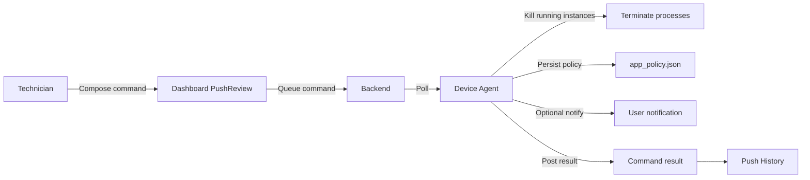

# Set App Policy (Application Allow/Block List)

The `set_app_policy` device command configures which applications are allowed or
blocked on a managed device. It supports **blocklist** mode (block specific apps)
and **allowlist** mode (only allow specific apps), kills running instances of
blocked apps, persists the policy to disk, and optionally notifies the device user.

## Overview

A technician or admin composes the **Set App Policy** command from the Dashboard
push-review page (group: **System**, permission: `root_access`). The device agent
executes it locally: it terminates any running instances of blocked applications,
writes a policy file to `C:\ProgramData\Homepot\app_policy.json`, and posts the
result back.

## Why this matters

POS terminals and kiosk devices should only run approved applications. Blocking
social media, games, browsers, and other non-essential apps:

- Reduces attack surface and malware risk
- Ensures the device stays focused on its intended purpose
- Supports compliance/audit requirements (PCI-DSS, SOC2, etc.)
- Prevents bandwidth abuse on cellular-connected devices

## Command payload

```json
{
  "mode": "blocklist",
  "apps": [
    {"name": "Facebook", "process": "facebook.exe"},
    {"name": "TikTok", "process": "tiktok.exe", "package": "com.zhiliaoapp.musically"}
  ],
  "enforce": true,
  "notify_user": true
}
```

### Parameters

| Parameter | Type | Required | Default | Description |
|-----------|------|----------|---------|-------------|
| `mode` | string | yes | — | `"blocklist"` (block listed apps) or `"allowlist"` (only allow listed apps) |
| `apps` | list | yes | — | List of app entries (see below) |
| `enforce` | bool | no | `true` | Kill running instances of blocked apps immediately |
| `notify_user` | bool | no | `false` | Show a notification to the device user when apps are blocked |

### App entry fields

| Field | Type | Required | Description |
|-------|------|----------|-------------|
| `name` | string | yes | Human-readable app name |
| `process` | string | yes | Process/executable name to match (case-insensitive substring) |
| `package` | string | no | Package ID (e.g., Android package name) — stored for reference |
| `executable` | string | no | Full executable path — stored for reference |

## Result shape

```json
{
  "status": "completed",
  "result": {
    "mode": "blocklist",
    "apps_configured": 2,
    "apps_blocked_running": 1,
    "killed_processes": ["Facebook.exe"],
    "policy_applied": true,
    "policy_path": "C:\\ProgramData\\Homepot\\app_policy.json",
    "platform": "Windows"
  }
}
```

| Field | Meaning |
|-------|---------|
| `mode` | The policy mode applied (`blocklist` or `allowlist`) |
| `apps_configured` | Number of apps in the policy |
| `apps_blocked_running` | Number of running processes killed |
| `killed_processes` | Names of processes that were terminated |
| `policy_applied` | Whether the policy file was written successfully |
| `policy_path` | Path to the persisted policy file |
| `platform` | OS platform where the command ran |

## Flow



## Agent side

### Handler: `_run_set_app_policy`

Located in `backend/src/homepot/agent/utils/command_poller.py`. The function:

1. Validates `mode` (`blocklist` or `allowlist`) and `apps` (non-empty list).
2. Normalizes app entries (supports both string and dict format).
3. If `enforce` is true, iterates all running processes and kills any whose
   name contains a blocked app's process name (case-insensitive).
4. Writes the policy to `C:\ProgramData\Homepot\app_policy.json` (or
   `~/Homepot/app_policy.json` on non-Windows).
5. On Windows, runs a PowerShell command (best-effort) for additional
   enforcement.
6. Optionally notifies the device user if apps were killed.
7. Returns the result with counts and paths.

### Policy file format

```json
{
  "mode": "blocklist",
  "apps": [
    {"name": "Facebook", "process": "facebook.exe", "package": null, "executable": null}
  ],
  "updated_at": "2026-11-21T12:00:00Z",
  "enforce": true
}
```

### Command type registration

- `COMMAND_TYPES`: includes `"set_app_policy"`
- `REQUIRED_PERMISSION`: gated on `root_access`
- Permission: `root_access` (Manage tier)

### AI integration

Registered in `ai/actions.py` `ACTION_REGISTRY` as T2 (reversible, root_access).
The AI can propose commands like:

> "Block TikTok and Facebook on all POS terminals in Site A"

The AI registry entry makes it available in the `propose_device_action` tool
docstring and the command payload reference.

## Dashboard (web UI)

The Compose Command page (`/device/:id/push-review`) includes a **Set App Policy**
template in the **System** group. Technicians can compose it with custom app lists.

## Security

- Gated on `root_access` permission (Manage tier)
- Process termination requires elevated privileges
- Policy file stored in `ProgramData\Homepot\` (all-users, protected directory)
- No credential/secret data involved

## Limitations

- **Process-level blocking only** — kills running instances by process name match.
  Does not prevent installation (would require OS-level AppLocker/WDAC on Windows
  or MDM profiles on macOS/iOS).
- **Substring matching** — process names are matched case-insensitively as
  substrings. A process named `notfacebook.exe` would also match `facebook`.
- **No periodic enforcement** — the policy is applied once when the command runs.
  A rebooted device won't re-enforce until the command is re-issued.
- **Cross-platform** — Linux/macOS get process termination only (no OS-level
  policy integration).

## Future enhancements

- **Periodic enforcement** — agent checks `app_policy.json` on startup and
  periodically kills blocked processes.
- **OS-level blocking** — Windows AppLocker/WDAC, macOS MDM profiles,
  Linux AppArmor.
- **Allowlist enforcement** — block any process not in the allowlist.
- **AI-proposable compliance scanning** — "ensure only approved apps run on
  kiosk terminals."
- **Violation reporting** — track which blocked apps were attempted and how
  many times.

## Files

| File | Role |
|------|------|
| `backend/src/homepot/agent/utils/command_poller.py` | `_run_set_app_policy` handler, dispatch, registration |
| `backend/src/homepot/app/ai_ops/compose_templates.py` | Backend compose template |
| `ai/actions.py` | AI `ACTION_REGISTRY` entry |
| `frontend/src/pages/Device/PushReview.jsx` | Frontend compose template |
| `backend/tests/test_ai_delegation_phase1.py` | Test expectations |

## Related

- `docs/adding-a-device-command.md` — how to add new device commands
- `docs/device-command-results.md` — command result flow and feedback
- `docs/collect-support-bundle.md` — support bundle (includes app_policy.json)
